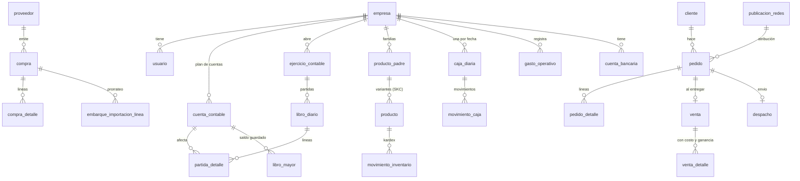

# Análisis de la v1 (Emprende)

> **Fase 0 · IntegraT** · Revisión solo de lectura de `C:\APP-Emprende\Emprende`, hecha el 2026-11-23.
> No se ejecutó código ni se conectó a la base de datos. Tampoco se abrieron `.Renviron` ni `config.yml` (credenciales).
>
> **Qué se revisó:** `CLAUDE.md`, `CURSOR_CONTEXT.md`, `.cursorrules`, `README.md`, `INSTALL.md`, `app.R`, `global.R`,
> `dependencies.R`, `mod_auth.R`, `R/r2_upload_imagen.R`, `R/ai_claude.R`, `R/compras_import_transito.R`, `R/db_sp_config.R`,
> `python/`, `tests/`, el log de shinyapps.io, la estructura de `R/`, `modules/`, `www/`, `scripts/` y `data/`, y estadísticas
> del esquema `../erp_pyme_gt_v3.sql`, buscadas con grep sin abrir el archivo completo.
> La revisión de los módulos de pantalla fue parcial: se leyeron sus contratos (mapa de módulos, firmas de SP), no cada línea.

---

## 1. Resumen ejecutivo

Emprende es un **ERP completo y ambicioso** para negocios guatemaltecos que venden por Instagram y WhatsApp.
Cubre ventas, caja, tesorería, inventario, compras e importaciones, despachos, marketing, contabilidad, impuestos y planilla.
El núcleo de negocio, lo más valioso, vive en **MySQL dentro de unos 314 stored procedures**. La interfaz es un
Shiny de escritorio con **15 secciones en la barra lateral**.

Para IntegraT, la v1 aporta **conocimiento de dominio** (qué operaciones existen, cómo se contabilizan y qué
le importa a un emprendedor guatemalteco). No sirve como base técnica ni visual. Sus problemas principales son estos:

1. **Aislamiento entre empresas débil.** Al iniciar sesión, la empresa activa se toma de `config.yml` y no del usuario (detalle en §5.1).
2. **Seguridad de contraseñas insuficiente**: SHA-256 sin sal, calculado en SQL.
3. **Lógica atada** a Guatemala, a Instagram/WhatsApp y a la importación desde SHEIN/TEMU, mediante ENUMs, códigos de cuenta y columnas por canal.
4. **Mantenibilidad baja**: un SQL de 27,261 líneas sin migraciones, módulos de hasta 5,074 líneas, CSS de 10,673 líneas y casi sin pruebas.
5. **Pensada para escritorio y para usuarios con formación contable** (tesorería, ejercicio, partida, acreedores).
6. **Python es nominal**: un archivo de 10 líneas que nadie invoca y `reticulate` no está instalado.

---

## 2a. Qué hace la app: módulos y flujos principales

| Sección (sidebar) | Qué resuelve | Flujo principal |
|---|---|---|
| Resumen del día | KPIs de hoy y del mes, narrativa del día, alertas y pedidos pendientes | Lectura (`sp_reporte_dashboard`, `sp_resumen_dia_insights`) |
| Ventas (pedidos) | Pedido con cliente, canal, forma de pago y entrega | crear → confirmar (mensaje WhatsApp) → cobrar; se reserva stock |
| Caja | Caja diaria: apertura, gastos, fondeo desde banco, cierre con conteo | abrir → movimientos → cerrar (diferencia) |
| Tesorería | Cuentas bancarias, movimientos y cuadre de gastos | Wizard inicial + movimientos |
| Inventario | Productos con variantes (talla y color, SKC), categorías y ubicaciones de bodega | alta → ajustes → traslados |
| Clientes | Cartera, direcciones, ranking, inactivos y cobros | CRUD + reportes |
| Compras mercadería | Compras locales e importaciones (casillero, tránsito, embarques con prorrateo) | registrar → recibir → pagar; carga por Excel/CSV |
| Gastos y acreedores | Gastos operativos, cuentas por pagar de servicios e insumos | registrar → pagar |
| Despachos | Picking, repartidores, mensajerías GT, entregas, devoluciones y etiquetas PDF | cola → picking → ruta → entrega (genera la venta contable) |
| Instagram | Publicaciones, campañas, ROI, mejor horario y copy con IA (Claude) | registrar post → métricas → atribución de ventas |
| Catálogo | Lookbook de productos con fotos | Lectura |
| Cheka Mi Tienda | Configuración de la tienda pública *NavegaEmprendiendo* (otro proyecto que comparte la BD) | Configuración |
| Finanzas | Estado de resultados, balance, flujo de caja, rentabilidad por canal y producto | Reportes |
| Impuestos | IVA mensual, ISR trimestral y anual, planilla IGSS, depreciaciones y cierre de ejercicio | Cálculo + registro |
| Configuración | Empresa, usuarios, roles y ejercicios contables | CRUD |

Hay 6 roles: `dueno`, `admin`, `vendedor`, `bodeguero`, `repartidor` y `contador`. El acceso a cada sección se filtra con `role_can()`.

## 2b. Stack, dependencias y manejo de datos y archivos

| Capa | v1 |
|---|---|
| UI | Shiny (R) + bslib (Bootstrap 5), `page_sidebar`, reactable, plotly, shinyWidgets y shinybusy |
| Lógica | **En MySQL**: alrededor de 314 SPs transaccionales. R funciona como capa delgada de llamadas (`db_call_sp`) |
| BD | MySQL/MariaDB `erp_pyme_gt` (Railway en remoto, XAMPP en local): 103 tablas, 16 triggers y 24 vistas |
| Esquema | Un solo archivo `../erp_pyme_gt_v3.sql`, fuera del repo de la app. Los cambios se aplican con `scripts/aplicar_*.R`, que **duplican** el SQL |
| Paquetes R | `dependencies.R` + `renv.lock` + `manifest.json` (rsconnect) |
| Python | `python/recommendations.py` (10 líneas, sin uso) y `requirements.txt` con solo `python-dateutil` |
| IA | `R/ai_claude.R`: genera copy para Instagram por HTTP (httr2) con el modelo fijo `claude-sonnet-4-20250514` y parsea el JSON con regex |
| Imágenes | Cloudflare R2 vía `aws.s3`, en un solo bucket público (`catalogo-productos`) servido por **`r2.dev`** |
| Archivos | Excel/CSV para importar compras en tránsito, PDF para etiquetas y `.RData` de 7 MB en la carpeta |
| Deploy | shinyapps.io con `deploy_shinyapps.R`, que **empaqueta `config.yml` y `.Renviron` con credenciales dentro del bundle** |
| Pruebas | 3 `test_that`. Las de BD se saltan solas si no hay conexión |
| Tamaño | Alrededor de 62,900 líneas entre R, CSS y JS. Los más grandes son `mod_despacho.R` (5,074), `custom.css` (10,673), `helpers_ui.R` (2,671), `mod_compras.R` (2,305) y `R/db_sp_finanzas.R` (2,221) |

## 2c. Modelo de datos actual (entidades y relaciones)

Observaciones:

- Las PK son `INT AUTO_INCREMENT` llamadas `id`, y las FK siguen el patrón `id_<tabla>`. Casi todas las tablas llevan `id_empresa`, con 2,222 menciones en el SQL.
- **Hay doble fuente de verdad** en `producto.stock_actual` frente a `movimiento_inventario`, y en `libro_mayor.saldo` frente a `partida_detalle`.
- `caja_diaria` es **única por fecha y empresa**. Eso impide tener varias cajas o turnos.
- El precio de venta está en **columnas por canal**: `precio_venta_fisico`, `precio_venta_instagram` y `precio_venta_whatsapp`.
- `pedido` y `venta` están separados: la venta contable nace al entregar. Esto encaja con ventas en línea, pero no con un restaurante.
- La auditoría se hace en la tabla `auditoria`, con JSON antes y después. No hay borrado lógico homogéneo (algunas tablas tienen `activo`).

## 2d. Partes atadas a un solo tipo de negocio (o a Guatemala)

| Acoplamiento | Dónde | Impacto para IntegraT |
|---|---|---|
| Canales de venta como **ENUM** (`instagram`, `whatsapp`, `tienda_fisica`, `facebook`) | `pedido.canal_venta`, `cliente.canal_origen` | Agregar un canal obliga a hacer un ALTER TABLE. Ni "mesa", ni "para llevar", ni "delivery app" encajan |
| Precios por canal como columnas | `producto` | No escala a más canales ni a listas de precios |
| Variantes talla/color + SKC de SHEIN/TEMU | `producto`, `helpers_skc.R`, compras en tránsito | Modelo pensado para ropa importada |
| Flujo pedido → picking → despacho → venta | ventas y despachos | Un restaurante necesita comanda → cocina → cobro y no tiene despacho físico |
| No hay recetas, insumos por platillo, mesas ni comandas | — | Hay que crear todo el vertical de restaurante |
| Códigos de cuenta **fijos dentro de los SP** (por ejemplo `'1112'`, `'4107'`) | `erp_pyme_gt_v3.sql` | El plan de cuentas no es configurable por país ni por tipo de negocio |
| IVA 12 %, IGSS, bonificación de Q250, ISR GT | SPs de impuestos y planilla, muchas referencias a 0.12/1.12 | No es configurable por país |
| Zona horaria forzada a `America/Guatemala` para todo el proceso | `global.R` | No hay multi-país |
| Departamentos y municipios de GT como tablas propias | `gt_departamento`, `gt_municipio` | Debería ser un catálogo genérico de divisiones por país |
| Marketing exclusivo de Instagram | `mod_marketing.R` | Funciona como concepto, pero está acoplado a una red social |
| "Tienda El Amanecer" fija en el código | `python/recommendations.py`, títulos | Hay datos de demo mezclados con el producto |

## 2e. Deuda técnica y malas prácticas que no debemos repetir

### Seguridad y aislamiento (crítico)

1. **La empresa activa sale de la configuración y no del usuario.** En `mod_auth.R:113` está
   `state$id_empresa <- cfg$app$default_empresa_id %||% u$id_empresa`. Si `default_empresa_id` está definido,
   como en `config.yml.example`, **todos los usuarios operan sobre la empresa 1**. Con `id_ejercicio` pasa lo mismo.
   Además, el aislamiento depende de que cada SP reciba y filtre `p_id_empresa`. No hay una defensa en la base de datos.
2. **Contraseñas con `SHA2(p_clave, 256)` sin sal**, calculadas dentro de MySQL. Son vulnerables a rainbow tables y viajan en texto plano hasta la BD.
   Las credenciales de demo están publicadas en el README, y el enlace "¿Olvidaste tu contraseña?" no hace nada.
3. **Secretos dentro del bundle de despliegue.** `deploy_shinyapps.R` genera `.Renviron`, `erp_deploy.env` y `config.yml` con credenciales y los sube a shinyapps.io.
4. `.Renviron.example` está versionado y **contiene el Account ID real de Cloudflare y la URL pública del bucket**.
   El `.gitignore` de la app no excluye `.RData`, `.RDataTmp*` ni `.Rhistory`, y hay un `.RData` de 7 MB en la carpeta.
5. `notify_err()` muestra **por defecto el mensaje técnico de MySQL** al usuario (`show_technical = TRUE`).

### Arquitectura y mantenibilidad

6. **Toda la lógica de negocio está en SPs de MySQL**: unos 314 en un archivo de 27,261 líneas. Son difíciles de probar, versionar y revisar.
   Para cambiarlos se edita el SQL y además una copia en `scripts/aplicar_*.R`, lo que produce **deriva** entre ambas copias.
   Hay archivos `.sql` temporales en `scripts/_tmp_insumos/` que violan la propia regla del proyecto.
7. **No hay migraciones versionadas.** El esquema se reconstruye "de principio a fin" y no hay forma de saber qué versión tiene cada BD.
8. `.db_sp_param_order()` mantiene a mano el orden de parámetros de muchos SP en un `switch`. Es frágil y causa errores 1265.
9. **Todo se carga con `source()` al entorno global.** No hay namespace, el orden de carga es frágil y los fragmentos de compras están listados en dos lugares.
10. **Módulos gigantes**: `mod_despacho.R` tiene 5,074 líneas y `custom.css` 10,673. La regla de "un solo CSS" produjo un monolito.
11. **Al iniciar sesión arrancan los 15 módulos de servidor**, aunque el usuario no los visite. Eso cuesta memoria y tiempo por sesión.
    El `state` compartido acumula más de 30 banderas de navegación cruzada (`volver_a_pedidos_tras_pub`, `compras_preservar_embarque`, etc.).
12. **Hacks de JavaScript dentro de `app.R`** para arreglar selectize dentro de modales, restaurar scroll y resetear `fileInput`.
    Son síntomas de una UI basada en modales y en controles pesados.
13. **Pruebas casi nulas**: 3 tests, y los de BD se saltan en silencio. Los tests tampoco se despliegan (`.rscignore`), lo cual está bien, pero no corren en CI.
14. Hay documentación desalineada: el README dice `inst/www/`, pero los estilos reales están en `www/`. `inst/www/` es legado.
15. Las instrucciones para el asistente (`.cursorrules`, `CURSOR_CONTEXT.md`) se enfocan en **ahorrar tokens** ("no leas archivos"), no en la calidad.
    Esto favoreció parches locales sobre diseño.

### Datos

16. Hay saldos y stocks guardados junto a sus movimientos (`stock_actual`, `libro_mayor.saldo`, `cliente.saldo_pendiente`, `total_compras`), con riesgo de que se desincronicen.
17. Los ENUMs se usan para conceptos de negocio que cambian (canales, roles, tipos de evento).
18. Existe una sola caja por día y por empresa.

### Imágenes (R2)

19. Se usa la **URL `r2.dev` en producción**. Cloudflare la documenta como *"rate-limited and should only be used for development purposes"*.
20. **La llave del objeto es `{SKC}.webp` en la raíz del bucket**. No hay prefijo por empresa, así que dos negocios con el mismo SKC se pisan.
    Además, reemplazar una foto no invalida la caché.
21. **Error de tipo:** se suben bytes JPG o PNG con nombre `.webp` y `Content-Type` del original. No hay conversión real a WebP.
22. **La subida pasa por el servidor Shiny** (`fileInput` → R → `aws.s3::put_object`). Sin compresión en el cliente, un celular con mala señal sube fotos de 3 a 5 MB.
23. No hay miniaturas, no se elimina el EXIF (que puede incluir la ubicación GPS) y no hay separación público/privado. Hoy no existen fotos privadas.

### Python e IA

24. `reticulate` no está instalado (el log de shinyapps.io dice `reticulate version: (none)`).
    `python/recommendations.py` no lee la BD y no se invoca desde R. La "integración R + Python" **no existe en la práctica**.
25. La IA usa un modelo fijo antiguo, parsea JSON con regex en lugar de salidas estructuradas y guarda la API key en `config.yml`.

## 2f. Ideas que conviene conservar (como concepto, no como código)

| Idea de la v1 | Cómo vive en IntegraT |
|---|---|
| Cada operación de negocio es **atómica** (los SP con transacción y rollback) | Comandos de la API dentro de una transacción de BD; la venta, el stock y el asiento se guardan juntos o no se guarda nada |
| **Asiento contable automático** por cada operación | Motor contable con reglas configurables (ver `PROPUESTA_ARQUITECTURA.md` §7) |
| `translate_db_error()` traduce errores técnicos a español claro | Catálogo de errores de dominio con mensaje amable y acción sugerida |
| **Narrativa del día** en el dashboard ("Resumen del día") | Panel de Inicio con asesor en lenguaje sencillo |
| `costo_total_real` (costo + flete + empaque) y **prorrateo de importación** | Costo puesto en bodega y costo promedio ponderado, con prorrateo de gastos de compra |
| `erp_sync_pulse` para avisar a otros módulos | Eventos de dominio (bus interno + outbox) |
| Plantillas de mensajes de WhatsApp | Plantillas por canal, configurables |
| Atribución de ventas a publicaciones | Campo "origen de la venta" genérico (canal + campaña) |
| Wizard de onboarding de tesorería y `prevalidar_cierre` | Onboarding guiado y checklists antes de cerrar caja o mes |
| Alertas del sistema y obligaciones fiscales con fecha límite | Avisos del asesor ("Mañana vence tu IVA") |
| Navegación según el rol | Permisos por rol, pero con navegación fija de máximo 5 secciones |
| Catálogo de divisiones políticas de GT para entregas | Catálogo genérico `cat_division_territorial` por país |

## 2g. Usabilidad: qué confunde o sobra

- **15 secciones en la barra lateral**, con emojis mezclados con iconos (`🛒 Compras Mercadería`, `💸 Gastos y Acreedores`). Supera por mucho el límite de 4 o 5.
- **Hay jerga contable y financiera a la vista**: *Tesorería, Acreedores, Ejercicio, Partida, Libro diario, Balance general, Depreciación, Liquidar IVA*.
- Hay **tabs dentro de secciones** (`inv_tabs`, `compras_tabs`, `despacho_tabs`, tabs de finanzas) y **modales con selectize**, que no funcionan bien en el celular, como demuestran los hacks de JS.
- Las **tablas (reactable) son la vista principal** de casi todo. En un teléfono obligan a hacer scroll horizontal.
- Un producto tiene **muchos campos**: 3 precios por canal, hashtags, descripción para Instagram, ubicación pasillo/estante/posición y stock mínimo.
- Hay **una calculadora cambiaria en la barra superior**, útil para un nicho (importadores) y ruido para todos los demás.
- Antes de vender hay que **abrir la caja** (`sp_assert_caja_abierta`). El flujo bloquea en lugar de guiar.
- Los mensajes de error muestran el **detalle técnico de MySQL**.
- El diseño es de **escritorio primero**, con sidebar de 260 px. Aunque existen 48 `@media` en el CSS, la arquitectura de información no es móvil.
- El login no tiene recuperación de contraseña ni registro propio. Los negocios no pueden darse de alta solos.

## 3. La v1 frente a la visión de IntegraT

| Capacidad de la visión | v1 | Acción en IntegraT |
|---|---|---|
| Registro propio y elección del tipo de negocio | ❌ (la empresa la crea un administrador) | **Nuevo** |
| Adaptación por tipo de negocio por configuración | ❌ (atado a ventas por redes) | **Nuevo**, es el eje de la arquitectura |
| Catálogo o menú con fotos | ✅ Parcial (catálogo de ropa, R2 público) | **Rediseñar** (fotos optimizadas, menú de restaurante) |
| Inventario | ✅ Completo (variantes, ubicaciones) | **Simplificar** (lo avanzado se muestra solo cuando se necesita) |
| Insumos y recetas con costo por platillo | ❌ (solo "insumos" de empaque) | **Nuevo** |
| Compras y gastos fijos/variables | ✅ (compras, importación, gastos, acreedores) | **Rediseñar**: un solo flujo "Lo que gastaste", con fijo o variable |
| Precio sugerido desde el costo y el margen | ❌ (precio manual por canal) | **Nuevo** |
| Ventas y caja (apertura, cierre, cuadre) | ✅ (pedidos + caja diaria) | **Rediseñar**: vender en 3 toques; la caja se abre sola si hace falta |
| Contabilidad automática por partida doble | ✅ (dentro de los SP) | **Conservar el concepto** con reglas configurables y sin códigos fijos |
| Asesor financiero en lenguaje sencillo | ⚠️ Parcial (narrativa del día, reportes contables) | **Rediseñar**: respuestas, no estados financieros |
| Punto de equilibrio (cuánto y cuándo) | ❌ | **Nuevo** |
| Fiscal GT configurable por país | ⚠️ (GT fijo en el código) | **Rediseñar** como configuración por país y régimen |
| Factura de compra por foto | ❌ (plantilla Excel/CSV) | **Nuevo**, mejora clave |
| R2 con público y privado, subida directa y miniaturas | ⚠️ (público vía r2.dev, subida por el servidor) | **Rediseñar** |
| Mobile-first, máximo 3 toques | ❌ | **Nuevo** |
| Multi-negocio con aislamiento real | ⚠️ (`id_empresa` sin RLS y empresa tomada de la config) | **Nuevo**: aislamiento en la BD (RLS) |
| Integración con plataformas externas (API-first) | ❌ | **Nuevo** |
| Despachos, picking y mensajerías | ✅ Muy completo | **Más adelante**: módulo opcional para "Ventas en línea" |
| Marketing en Instagram | ✅ | **Más adelante**: el asesor sugiere qué promocionar |
| Planilla IGSS, depreciaciones e ISR anual | ✅ | **Más adelante** (después del MVP), por país |
| Tesorería con varias cuentas bancarias | ✅ | **Simplificar**: "¿Dónde está tu dinero?" (efectivo, banco, por cobrar) |
