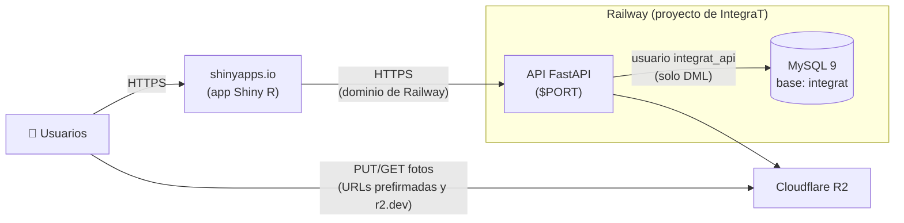

# Configuración del servidor y de los despliegues: IntegraT

> **Piloto en Railway (D-21):** la API y la base **MySQL 9** (D-19) corren en Railway, con HTTPS que genera Railway; la app en shinyapps.io. Receta: `infra/railway.md`. Las secciones de este documento que mencionan PostgreSQL, Caddy, un servidor propio o un firewall por IP describen la alternativa de servidor propio / Azure y quedan pendientes de revisar.

> **Guía del piloto.** shinyapps.io para la app Shiny; API y MySQL en Railway; migración posterior a Azure.
> Las secciones 3 a 6 describen la alternativa de **servidor propio con PostgreSQL**; no se usan en el piloto actual (se conservan como referencia).
> **Regla absoluta:** las credenciales viven **solo en `.env`**. Este documento usa marcadores como `<CONTRASEÑA_FUERTE>`; nunca escribas valores reales aquí.

---

## 1. Topología del piloto



- **Lo único expuesto a internet es la API**, por HTTPS con el certificado de Railway. La API se endurece antes de abrirla (D-21): límite de intentos, `Idempotency-Key`, sin `/docs` fuera de `dev`, límite de tamaño.
- **La base la usa solo la API**, con un usuario de mínimos privilegios (`integrat_api`); las migraciones usan `integrat_owner`.
- Los usuarios nunca llaman a la API directamente: lo hace la app Shiny. Las fotos van del celular directo a R2.
- Receta de despliegue: `infra/railway.md`.

---

## 2. Variables de entorno (`.env`)

- El archivo `.env` vive en la raíz del proyecto en tu máquina de desarrollo y **en el servidor** (junto a `docker-compose.yml`). **Nunca se sube a Git**: ya está en `.gitignore`.
- `.env.example` (versionado) lista los nombres **sin valores**.
- La API y el worker leen la configuración **solo de variables de entorno** (pydantic-settings). Ningún valor por defecto contiene secretos.
- **Logs:** nunca se imprimen variables de entorno, cadenas de conexión ni tokens. La configuración se registra enmascarada (`DB_PASSWORD=****`).

| Variable | Quién la usa | Descripción |
|---|---|---|
| `APP_ENV` | todos | `dev`, `piloto` o `prod` |
| `DB_HOST`, `DB_PORT`, `DB_NAME`, `DB_USER`, `DB_PASSWORD` | API, worker | Conexión a MySQL. `DB_NAME=integrat` siempre. `DB_USER` = rol de ejecución (`integrat_api`) |
| `DB_SSLMODE` | API, worker | `required` como mínimo en Railway; `verify_identity` (con `DB_SSL_CA`) si se dispone del certificado |
| `DB_MIGRATIONS_USER`, `DB_MIGRATIONS_PASSWORD` | solo migraciones | Rol dueño del esquema (`integrat_owner`); no lo usa la API en ejecución |
| `API_JWT_SECRET` | API | Firma de tokens (32 bytes aleatorios o más) |
| `API_ALLOWED_ORIGINS` | API | Vacío en el piloto: quien llama a la API es el servidor de Shiny, no el navegador |
| `R2_ACCOUNT_ID` | API, worker | ID de la cuenta de Cloudflare |
| `R2_PUBLIC_BUCKET`, `R2_PUBLIC_ACCESS_KEY_ID`, `R2_PUBLIC_SECRET_ACCESS_KEY` | API, worker | Token con permiso solo sobre el bucket público |
| `R2_PRIVATE_BUCKET`, `R2_PRIVATE_ACCESS_KEY_ID`, `R2_PRIVATE_SECRET_ACCESS_KEY` | API, worker | Token con permiso solo sobre el bucket privado |
| `R2_PUBLIC_BASE_URL` | API | Piloto: la URL `https://pub-….r2.dev`; producción: `https://img.<dominio>` |
| `ANTHROPIC_API_KEY` | worker | Solo si el modo IA está habilitado en el entorno |
| `IA_PRECIO_POR_PAGINA_GTQ` | API | Precio fijo mostrado al usuario (se define después de la prueba de modelos) |
| `API_BASE_URL` | **app Shiny** | URL HTTPS de la API. **Es la única configuración que necesita Shiny y no es secreta** |

**shinyapps.io:** la app Shiny **no lleva secretos**.
- `API_BASE_URL` se entrega en `app/config.yml` (sección `shinyapps`) dentro del bundle, que es seguro porque no es secreto. shinyapps.io define `R_CONFIG_ACTIVE=shinyapps`, según su documentación.
- `infra/desplegar_app.R` verifica que **no** se incluya `.env` ni secretos en el bundle.

---

## 3. (Alternativa: servidor propio) Preparar el servidor

> Asume Linux (Ubuntu Server LTS o similar) con Docker. Si tu servidor es Windows, se recomienda una VM Linux o WSL2 para los contenedores.

1. **Sistema**: actualizaciones automáticas de seguridad, zona horaria UTC (la app usa la zona de cada negocio) y NTP activo.
2. **Usuario de despliegue** sin login por contraseña: SSH solo con llave, `PermitRootLogin no` y `PasswordAuthentication no`.
3. **Docker + Docker Compose**. Los servicios corren como usuario no root dentro de los contenedores.
4. **Firewall** (por ejemplo, `ufw`):
   ```
   default deny incoming
   allow 22/tcp  from <TU_IP_ADMIN>
   allow 443/tcp from 54.204.34.9, 54.204.36.75, 54.204.37.78,
                      34.203.76.245, 3.217.214.132, 34.197.152.155   # shinyapps.io
   allow 443/tcp from <TU_IP_ADMIN>
   allow 80/tcp  (solo si Let's Encrypt usa el reto HTTP-01; o usar el reto DNS)
   # NO abrir 5432 (PostgreSQL) ni 8000 (API sin TLS)
   ```
   Las IPs de shinyapps.io provienen de su documentación oficial (*Accessing Databases → Firewalls*, consultada el 2026-11-23).
   **Revísalas antes de configurar**: shinyapps.io anunció su paso a Posit Connect Cloud y la lista puede cambiar.
   Cuando se integren webhooks externos (pasarelas, certificador FEL), habrá que abrir 443 a esos orígenes o ponerlos detrás de una ruta con firma HMAC.
5. **Fail2ban** o similar para SSH.
6. **Límites de tasa** en Caddy o la API (por IP y por token) y tamaños máximos de petición.

---

## 4. (Alternativa: servidor propio) HTTPS para la API sin dominio propio

shinyapps.io debe llamar a la API por **HTTPS con un certificado válido**. Opciones:

| Opción | Cómo | Comentario |
|---|---|---|
| **Dominio barato** ✅ | Registrar un dominio (~US$10 a 15 al año) y crear `api.<dominio>` → IP del servidor. Caddy obtiene el certificado de Let's Encrypt automáticamente | **Recomendado (R-03)**: también sirve después para la app, las fotos en R2 y el correo |
| Nombre DNS gratuito | Servicios de DNS dinámico (por ejemplo DuckDNS) → `integrat-api.<servicio>` + Caddy con Let's Encrypt | Gratis y suficiente para el piloto. Dependes de un tercero |
| Certificado para la IP | Let's Encrypt anunció certificados para direcciones IP de corta duración | **Verificar disponibilidad y soporte en Caddy** antes de usarlo |
| Certificado autofirmado | — | ❌ No: obligaría a desactivar la verificación TLS en el cliente |

`Caddyfile` mínimo (ilustrativo):
```
api.<host> {
  reverse_proxy api:8000
  encode gzip
  header Strict-Transport-Security "max-age=31536000"
}
```

---

## 5. (Alternativa: servidor propio) PostgreSQL: base nueva `integrat`

> **La base de la v1 (`erp_pyme_gt`, en MySQL) no se usa ni se toca.** Si tu servidor tiene MySQL por la v1, PostgreSQL se instala **aparte** (en el contenedor oficial `postgres`) sin modificar MySQL.

### 5.1 Instalación y endurecimiento

- Contenedor `postgres:18` (o 17), con volumen persistente y **sin publicar el puerto 5432** hacia el host (solo red interna de Docker).
  Si corre fuera de Docker: `listen_addresses = 'localhost'`.
- `password_encryption = scram-sha-256`.
- `pg_hba.conf`: solo `scram-sha-256` desde la red interna de Docker. **Sin reglas `trust`.**
- Limitar `max_connections` y usar un pool en la API. Definir `statement_timeout` para el rol de la app.

### 5.2 Base y roles (lo ejecuta un administrador una sola vez; las contraseñas se ingresan por consola con `\password`)

```sql
CREATE ROLE integrat_owner LOGIN;            -- migraciones (dueño de objetos)
CREATE ROLE integrat_api   LOGIN;            -- API y worker en ejecución
CREATE DATABASE integrat OWNER integrat_owner ENCODING 'UTF8' TEMPLATE template0;

REVOKE ALL ON DATABASE integrat FROM PUBLIC;
GRANT CONNECT ON DATABASE integrat TO integrat_api;
-- Ningún rol de IntegraT recibe CONNECT a otras bases del servidor.
-- Los GRANT por esquema y las políticas RLS los crean las migraciones (Fase 1).
\password integrat_owner
\password integrat_api
```

- `integrat_api` **no es superusuario**, no es dueño de las tablas y **no tiene `BYPASSRLS`**. Las tablas usan `FORCE ROW LEVEL SECURITY`.
- En el `.env`: `DB_USER=integrat_api` y `DB_NAME=integrat`. Las migraciones usan `DB_MIGRATIONS_USER=integrat_owner`.

### 5.3 Backups

- `pg_dump` diario (formato custom), **cifrado** (age o gpg) y copiado **fuera del servidor**, por ejemplo a un bucket R2 de backups distinto, con su propio token y ciclo de vida de retención (30 diarios + 12 mensuales).
- **Prueba de restauración mensual** en un entorno de prueba.
- Más adelante: archivo de WAL para recuperación a un punto en el tiempo.

---

## 6. Alternativa (no recomendada): shinyapps.io conectado directo a PostgreSQL

Si en algún momento decides que Shiny lea la BD directamente (por ejemplo, para la analítica pesada), estos son los **mínimos de seguridad**:

| Medida | Configuración |
|---|---|
| Firewall | Abrir 5432 **solo** a las 6 IPs de shinyapps.io (cada una como `/32`) |
| SSL obligatorio | `ssl = on` con un certificado válido; en `pg_hba.conf` solo líneas **`hostssl`** para esas IPs con `scram-sha-256`. En el cliente R: `sslmode=verify-full` |
| Usuario dedicado | `integrat_app_ro`: `CONNECT` solo a `integrat`, `USAGE` + `SELECT` solo en los esquemas `rpt` y `dw`, sin escritura, `CONNECTION LIMIT` bajo y `statement_timeout` de 15 s |
| Aislamiento | RLS forzado también para este rol. ⚠️ El contexto de negocio (`app.negocio_id`) lo fijaría la app, así que **una falla en el código de Shiny o la filtración de esta credencial expondría datos de todos los negocios** |
| Credencial | Viajaría dentro del bundle de shinyapps.io (`.Renviron` generado al desplegar, nunca en Git), con rotación cada 90 días |

Por el último punto, **se recomienda mantener R-01**: todo pasa por la API, que entrega datasets ya filtrados por negocio.

---

## 7. Preparado para Azure

Todo se construye como **contenedores configurados solo por variables de entorno**, siguiendo los principios *twelve-factor*.

| Pieza | Piloto | Azure (propuesta) |
|---|---|---|
| App Shiny | shinyapps.io (bundle con rsconnect). **Además se mantiene un `Dockerfile`** (rocker) que se prueba en CI | **Azure Container Apps** con *session affinity* (Shiny necesita sesiones sticky y websockets) |
| API | Railway (contenedor) | Azure Container Apps (escala por peticiones) |
| Worker | Railway (contenedor) | Azure Container Apps (worker) o Container Apps Jobs |
| MySQL | Railway | **Azure Database for MySQL – Flexible Server** (backups y alta disponibilidad administrados) |
| Secretos | `.env` | **Azure Key Vault** → variables de entorno de cada contenedor (mismos nombres) |
| TLS y dominio | Dominio HTTPS que genera Railway | Certificados administrados de Container Apps o Front Door |
| Imágenes | Cloudflare R2 | Se mantiene R2 (egreso gratis); la capa `almacenamiento` permitiría Azure Blob si se decide |
| Logs | Archivos y stdout | Azure Monitor / Log Analytics (sin secretos en los logs) |

**Pasos de migración:**
1. Crear los recursos en Azure.
2. Restaurar el último respaldo (`mysqldump`) en Flexible Server.
3. Cargar los secretos en Key Vault.
4. Desplegar las mismas imágenes.
5. Cambiar `API_BASE_URL` (y DNS).
6. Ventana corta de solo lectura para el corte final.

---

## 8. Checklist antes del piloto

- [ ] CI en verde en GitHub.
- [ ] API en Railway con HTTPS válido (`infra/railway.md`); `/docs` da 404 y el sexto login fallido da 429.
- [ ] La API corre con `integrat_api` y `DB_SSLMODE=required`; `integrat_owner` solo para migraciones.
- [ ] `API_JWT_SECRET` nuevo, distinto del de desarrollo, cargado solo en el panel de Railway.
- [ ] Base `integrat` migrada, con catálogos y **una restauración de respaldo probada**.
- [ ] Prueba de aislamiento entre negocios en verde (CI) y verificada a mano con dos cuentas.
- [ ] Bundle de shinyapps.io verificado con `infra/desplegar_app.R`: sin `.env` ni secretos.
- [ ] Buckets R2 creados (`integrat-publico-piloto` con r2.dev **activado**, `integrat-privado-piloto` **sin** acceso público), CORS y tokens de mínimo privilegio (cuando lleguen las fotos, Fase 2).
- [ ] Política de privacidad publicada (`PROPUESTA_ARQUITECTURA.md` §10).
