# Diseño UX/UI: IntegraT

> **Fase 0** · Principios, mapa de navegación, flujos clave, wireframes, sistema de diseño, adaptación por tipo de negocio y librerías para Shiny.
> La v1 **no** es referencia visual. Todo se diseña desde cero.

---

## 1. Principios, convertidos en reglas verificables

> **v2:** se incorporaron las decisiones de `DECISIONES.md`: trato de "tú", compras en 3 modos (a mano, plantilla, foto con IA), control de la IA y siempre en línea.

| Principio | Regla de diseño que se puede comprobar en una revisión |
|---|---|
| Una pantalla, una tarea | Cada pantalla tiene **1 botón primario** (lleno, abajo, a todo el ancho). Lo demás son acciones secundarias |
| Máximo 3 toques | Vender, foto de factura y ver cómo va el negocio están a **3 toques o menos desde Inicio** (se mide en pruebas) |
| Lo complejo queda escondido | No aparecen las palabras *asiento, partida, debe, haber, pasivo, devengado, ejercicio, libro, conciliación* en ninguna pantalla del flujo normal |
| Revelación progresiva | Las funciones avanzadas (variantes, entregas, varias cajas, clientes con crédito, impuestos detallados) se **activan cuando se usan** o cuando el asesor las sugiere |
| Lenguaje cotidiano | Se escribe en un nivel de lectura de primaria alta. Cualquier término técnico lleva una explicación de una línea (ⓘ) |
| Visual antes que texto | Cada número importante tiene icono, color con significado y tamaño grande. Las tablas no se usan en el celular; se usan **listas de tarjetas** |
| Mobile-first | Se diseña primero para 360 a 390 px. Objetivos táctiles de **48 px como mínimo**. Navegación inferior con 5 secciones |
| Cero miedo | Toda acción que cambia datos ofrece **"Deshacer" durante 8 s** (toast). Para borrar, se confirma en lenguaje amable. Los errores dicen qué pasó y qué hacer |
| Acompañamiento | Onboarding de 4 pasos o menos. Cada lista vacía enseña la siguiente acción. Los consejos del asesor aparecen en contexto |
| Accesible | Contraste AA (AAA en los números grandes). Texto ajustable (3 tamaños). No se depende solo del color. Las imágenes ocupan menos de 100 KB en las listas |

---

## 2. Mapa de navegación

**Navegación inferior fija (5 secciones):**

```
┌───────┬───────┬───────┬────────┬───────┐
│  🏠   │  🛒   │  ➕   │   📦   │  ☰    │
│Inicio │Vender │       │Productos│ Más  │
│       │       │(acción│ / Menú │       │
│       │       │rápida)│        │       │
└───────┴───────┴───────┴────────┴───────┘
```

- **➕ (central, destacado)** abre una hoja inferior con las acciones frecuentes que no son vender:
  **🧾 Registrar compra** (a mano, plantilla o foto con IA) · **💸 Registrar gasto** · **📦 Agregar producto** · **💰 Cerrar el día**.
- Las preferencias de la hoja ➕ se ordenan por uso.

```mermaid
flowchart TD
  ON["Bienvenida / Registro"] --> TN["¿Qué tipo de negocio tienes?"]
  TN --> OB["Onboarding guiado\n(3 o 4 pasos)"]
  OB --> IN

  subgraph NAV["Navegación inferior"]
    IN["🏠 Inicio\n¿Cómo va mi negocio hoy?"]
    VE["🛒 Vender"]
    MAS_RAP["➕ Acción rápida"]
    PR["📦 Productos / Menú"]
    MA["☰ Más"]
  end

  IN --> IN_D["Detalle: Lo que vendiste hoy"]
  IN --> IN_PE["Tu meta del mes\n(punto de equilibrio)"]
  IN --> IN_C["Consejo del asesor → acción"]
  IN --> INF["Informe del mes"]

  VE --> VE_C["Carrito / Comanda"]
  VE_C --> VE_P["Cobrar\n(efectivo, tarjeta, transferencia)"]
  VE_P --> VE_OK["¡Listo! Recibo / WhatsApp"]
  VE --> VE_H["Ventas de hoy\n(ver, anular)"]

  MAS_RAP --> FF["🧾 Registrar compra"]
  FF --> FF_M["✍️ A mano (guiado)"]
  FF --> FF_P["📄 Plantilla"]
  FF --> FF_IA["📷 Foto + IA\n(confirma el costo)"]
  FF_M & FF_P & FF_IA --> FF_R["Revisa tu compra"]
  FF_R --> FF_OK["Compra guardada\n+ avisos de precios"]
  MAS_RAP --> GA["💸 Registrar gasto"]
  MAS_RAP --> PRN["📦 Agregar producto"]
  MAS_RAP --> CC["💰 Cerrar el día"]
  CC --> CC_C["Cuenta tu efectivo"]
  CC_C --> CC_R["Resumen del día"]

  PR --> PR_D["Ficha de producto / platillo"]
  PR_D --> PR_R["Receta (restaurante)"]
  PR_D --> PR_P["Precio sugerido"]
  PR --> PR_I["Lo que tengo (existencias)\n+ ajustar / merma"]
  PR --> PR_S["Insumos (restaurante)"]

  MA --> MA_G["Gastos (fijos y variables)"]
  MA --> MA_CO["Compras y proveedores"]
  MA --> MA_CL["Clientes y lo que te deben*"]
  MA --> MA_INF["Informes"]
  MA --> MA_IMP["Tus impuestos*"]
  MA --> MA_CT["Para tu contador*"]
  MA --> MA_EQ["Tu equipo*"]
  MA --> MA_NEG["Mi negocio (datos, logo, margen)"]
  MA_NEG --> MA_IA["Lectura con IA\n(interruptor, saldo, límite, historial)"]
  MA --> MA_TIT["Mis negocios / consolidado por NIT*"]
  MA --> MA_AYU["Ayuda"]
```



`*` = revelación progresiva: aparece cuando el negocio la activa o la necesita.

---

## 3. Flujos clave, paso a paso

### 3.1 Registro y elección del tipo de negocio (≤ 2 minutos)

1. **Bienvenida**: "Administra tu negocio desde el celular. Tú vende, nosotros hacemos las cuentas." → **[Empezar]**
2. **Cuenta**: nombre, celular o correo y contraseña. Opcional: entrar con Google. Se verifica con un código por SMS o correo.
3. **"¿Qué tipo de negocio tienes?"**: tarjetas grandes con ilustración.
   🛍️ *Vendo en línea* · 🍽️ *Tengo un restaurante o comedor* · *(pronto: tienda, servicios…)*.
4. **"¿Cómo se llama tu negocio?"**: nombre + logo opcional (foto).
5. **"¿Das factura?"**: *Sí, soy pequeño contribuyente* · *Sí, régimen general* · *No sé / Todavía no*.
   Esta última elección configura lo mínimo; el asesor lo recuerda más adelante.
6. **Primeros pasos según el tipo**, como checklist en Inicio y no como un muro:
   - En línea: "📷 Agrega tu primer producto con una foto" → "🛒 Haz tu primera venta" → "💸 Anota tus gastos fijos".
   - Restaurante: "🍽️ Agrega tus 5 platillos más vendidos" → "🥕 Dinos qué lleva tu platillo estrella" → "🛒 Haz tu primera venta".

### 3.2 Primera venta (3 toques)

**Ventas en línea:**
1. Toque **🛒 Vender**: cuadrícula de productos con foto, los más vendidos primero y buscador arriba.
2. Toque en el **producto**: se agrega al carrito. Si tiene variantes, una hoja pequeña pregunta "¿Qué talla?". La barra inferior muestra "1 producto · Q289 → Cobrar".
3. Toque **[Cobrar Q289]**: se elige el medio de pago (el último usado viene preseleccionado) y se confirma.
   → "¡Vendiste Q289! 🎉" con **[Enviar recibo por WhatsApp]** y "Deshacer".

Opcionales, sin bloquear la venta: canal (WhatsApp, Instagram…), cliente, envío. Se recuerda el último canal.

**Restaurante:**
1. **🛒 Vender** → elegir *Para comer aquí (Mesa 3)* · *Para llevar* · *A domicilio*. Es un selector en la parte superior; se recuerda el último.
2. Se tocan los platillos (cada toque suma 1). Una pulsación larga permite agregar notas ("sin cebolla").
3. **[Cobrar]** o **[Enviar a cocina]** si la capacidad `comanda_cocina` está activa.

**Caja:** si no hay caja abierta, la primera venta en efectivo **la abre sola** y pregunta una vez, sin bloquear:
"¿Con cuánto efectivo empezaste hoy? (puedes dejarlo en 0)". La v1 bloqueaba la venta en este punto.

### 3.3 Registrar una compra: tres caminos, una misma revisión

**➕ → 🧾 Registrar compra** muestra: "¿Cómo quieres cargarla?"

| Opción | Texto | Costo |
|---|---|---|
| ✍️ **A mano** | "Escribe lo que compraste, te guiamos paso a paso" | Gratis |
| 📄 **Con plantilla** | "Llena una hoja sencilla (Excel o Google Sheets) y súbela" | Gratis |
| 📷 **Con foto + IA** | "Toma una foto y la leemos por ti" | **Q0.40 por página** (precio de ejemplo; se ve antes de usar) |

- Si la IA está **apagada**, la tercera opción dice "Activar lectura con IA" y lleva a la configuración. Nunca se activa sola.
- Se recuerda la última opción usada; la más usada aparece primero.
- En los caminos sin IA se puede **adjuntar la foto como respaldo** (gratis, sin leerla).

**A) A mano (guiado), una pregunta por pantalla:**
1. ¿A quién le compraste? (buscar o "nuevo").
2. ¿Tiene factura? Serie y número (opcional) y fecha (hoy por defecto).
3. ¿Qué compraste? Buscador con lo que más compras arriba. Por línea: **cantidad**, **unidad** y **cuánto pagaste por esa línea**.
4. ¿Cuál es el total de la factura? → "Coincide ✅" o "Hay Q3.50 de diferencia".
5. ¿Ya la pagaste? → **Revisar**.

**B) Con plantilla:**
1. **[Descargar mi plantilla]**: viene con tus productos en una lista desplegable y 4 columnas (Producto, Cantidad, Unidad, Total).
2. La llenas en la compu o en el celular y la subes.
3. La app muestra "Entendimos 12 líneas ✅ · 1 producto no lo reconocimos". Después se piden los datos de la factura (como en A, pasos 1, 2 y 5) → **Revisar**.

**C) Con foto + IA (3 toques + revisar):**
1. **📷**: se abre la cámara con una guía en pantalla ("Pon la factura completa dentro del marco, con buena luz"). Se revisa la calidad en el momento y se pueden agregar páginas.
2. **Confirmar el costo**: "Leer esta factura (2 páginas) cuesta **Q0.80**. Tu saldo: Q18.40 · Este mes llevas Q6.40 de tu límite de Q25". **[Leer con IA · Q0.80]** · [Llenar a mano gratis].
3. **"Leyendo tu factura…"** (de 5 a 15 s). Si sales, te avisamos al terminar. Si la lectura falla: "No pudimos leerla. **No se te cobró.** ¿La llenas a mano? (la foto queda a la vista)".
4. **Revisar** (pantalla común a los 3 caminos), en una sola pantalla:
   - Arriba: proveedor, fecha y total (grandes).
   - Lista de productos: cada línea con su emparejamiento ("→ Aceite Capullo 1 gal").
   - En ámbar: lo dudoso ("¿Es *Pollo entero* o *Pechuga*?"), con opciones de un toque.
   - La miniatura de la foto se amplía al tocarla.
   - Pregunta "¿Ya la pagaste?": *Sí, en efectivo* · *Sí, por banco* · *No, la debo*.
5. **[Guardar compra]** → "Listo. Actualizamos tu inventario y tus costos." Después aparecen las **tarjetas de impacto**:
   "🔺 El aceite subió 8 %. Tu *Pollo frito* ahora deja Q2 menos. **[Ver precio sugerido]**".
   Si se usó la IA, la ficha de la compra muestra "Lectura con IA: Q0.80 (repartido en el costo de estos productos)" con un ⓘ que lo explica.

### 3.3.1 Control de la IA (Más → Mi negocio → Lectura con IA)

```
┌──────────────────────────────────────┐
│ ← Lectura de facturas con IA         │
│ Leer facturas con IA      [  ON ◉ ]  │
│ ⓘ Enviamos solo la foto de la factura│
│   a un servicio de IA para leerla.   │
│   Tus fotos se guardan en privado.   │
├──────────────────────────────────────┤
│ TU SALDO                             │
│ Q 18.40                [ Recargar ]  │
│ Incluidas en tu plan: 6 de 10 libres │
├──────────────────────────────────────┤
│ LÍMITE DEL MES                       │
│ ███████░░░░░░  Q6.40 de Q25.00       │
│ [ Cambiar límite ]                   │
├──────────────────────────────────────┤
│ HISTORIAL                       Ver ›│
│ 22/11 La Económica · 2 pág · Q0.80 ✅│
│ 20/11 Mercado · 1 pág · Q0.40 ✏️ corr.│
│ 18/11 Gasolinera · 1 pág · Q0 ↩ reemb.│
└──────────────────────────────────────┘
```

- **Al activarla por primera vez**: una pantalla explica qué se envía, a quién, cuánto cuesta, dónde se guardan las fotos y que se puede apagar cuando quieras. Se acepta con **[Activar]**.
- **Al llegar al 80 % del límite**: "Llevas Q20 de tu límite de Q25 este mes". **Al 100 %**: la opción de foto con IA se pausa y se ofrecen **A mano** y **Plantilla** (gratis) o **[Subir límite]**.
- El **historial** muestra fecha, proveedor, páginas, costo y resultado (✅ leída, ✏️ corregida, ↩ reembolsada), y se puede exportar.

### 3.4 Cierre de caja ("Cerrar el día")

1. **➕ → 💰 Cerrar el día** (o el recordatorio de Inicio a la hora configurada).
2. **"Cuenta el efectivo que tienes"**: un solo número grande, con teclado numérico.
   Opcionalmente se cuenta por billetes y monedas ("Ayúdame a contar").
3. **Resultado**, con color y significado:
   - ✅ "¡Cuadra perfecto!"
   - 🟡 "Te sobran Q15" o "Te faltan Q15". Para menos de Q20 (configurable): "Es una diferencia pequeña. ¿Quieres anotar por qué?", con motivos rápidos.
   - 🔴 Diferencia grande: "Te faltan Q240. Revisemos juntos:" y se muestran las ventas en efectivo y los gastos del día para encontrar el error.
4. **Resumen del día**: vendiste, gastaste y te queda. Comparación con el mismo día de la semana anterior. **[Compartir por WhatsApp]**.
5. Opcional: "¿Vas a depositar efectivo al banco?".

### 3.5 Ver el informe del mes

1. **🏠 Inicio** → tarjeta **"Tu mes"** → **[Ver informe]**.
2. Informe en **tarjetas verticales** (deslizar), cada una con una pregunta:
   1. **¿Gané o perdí?**: "Ganaste **Q6,240**" (verde) con una barra *vendiste → costó → gastaste → te queda*.
   2. **¿En qué gasté más?**: 3 categorías principales con su barra y "La renta es el 32 % de tus gastos".
   3. **¿Qué producto deja más?**: top 3 por ganancia total, no por ventas, y el que **menos** deja.
   4. **¿Cuándo dejé de perder?**: "Cubriste tus gastos el **día 19**" (punto de equilibrio alcanzado).
   5. **Comparación**: frente al mes anterior (↑ ↓ en lenguaje sencillo).
   6. **Qué hacer ahora**: 1 a 3 consejos con botón de acción ("Sube Q3 el *Combo 2*" → abre el precio sugerido).
3. **[Compartir PDF]** · **[Enviar a mi contador]** (si está configurado).

---

## 4. Wireframes (390 px)

### 4.1 Inicio

```
┌──────────────────────────────────────┐
│ Comedor Doña Mari        🔔  (MG)    │
│ Martes 24 de noviembre               │
├──────────────────────────────────────┤
│ ┌──────────────────────────────────┐ │
│ │ HOY VAS GANANDO          ✅      │ │
│ │ Q 1,245                          │ │
│ │ Vendiste Q2,980 · Gastaste Q1,735│ │
│ └──────────────────────────────────┘ │
│ ┌──────────────────────────────────┐ │
│ │ TU META DEL MES                  │ │
│ │ ████████████░░░░░  72 %          │ │
│ │ Te faltan Q5,180 para no perder. │ │
│ │ A tu ritmo, lo logras el día 26. │ │
│ └──────────────────────────────────┘ │
│ ┌──────────────────────────────────┐ │
│ │ 💡 QUÉ HACER AHORA               │ │
│ │ El Pollo frito deja poco margen  │ │
│ │ desde que subió el aceite.       │ │
│ │              [ Ver precio ›]     │ │
│ └──────────────────────────────────┘ │
│ ┌───────────────┐ ┌────────────────┐ │
│ │ ⚠️ Se acaba    │ │ 📅 Mañana vence │ │
│ │ Aceite (2 L)  │ │ Renta Q2,000   │ │
│ └───────────────┘ └────────────────┘ │
│  Tu mes ›                            │
├──────────────────────────────────────┤
│  🏠      🛒      (➕)      🍽️      ☰  │
│ Inicio  Vender           Menú    Más │
└──────────────────────────────────────┘
```

### 4.2 Vender (Ventas en línea)

```
┌──────────────────────────────────────┐
│ ← Vender              Canal: WhatsApp▾│
│ ┌──────────────────────────────────┐ │
│ │ 🔍 Buscar producto               │ │
│ └──────────────────────────────────┘ │
│ [Todos] [Blusas] [Vestidos] [Acces.] │
│ ┌─────────┐ ┌─────────┐ ┌─────────┐  │
│ │ [foto]  │ │ [foto]  │ │ [foto]  │  │
│ │Blusa    │ │Vestido  │ │Aretes   │  │
│ │lino     │ │floral   │ │dorados  │  │
│ │Q289  ①  │ │Q350     │ │Q75      │  │
│ └─────────┘ └─────────┘ └─────────┘  │
│ ┌─────────┐ ┌─────────┐ ┌─────────┐  │
│ │ [foto]  │ │ [foto]  │ │ [foto]  │  │
│ │...      │ │...      │ │...      │  │
├──────────────────────────────────────┤
│ ┌──────────────────────────────────┐ │
│ │ 1 producto        COBRAR Q289  › │ │
│ └──────────────────────────────────┘ │
└──────────────────────────────────────┘
```

### 4.3 Vender (Restaurante)

```
┌──────────────────────────────────────┐
│ ← Vender                             │
│ [🍽️ Aquí: Mesa 3▾] [🥡 Llevar] [🛵]   │
│ [Desayunos] [Almuerzos] [Bebidas]    │
│ ┌──────────────────────────────────┐ │
│ │ [ft] Pollo frito          Q35  2 │ │
│ ├──────────────────────────────────┤ │
│ │ [ft] Pepián               Q40    │ │
│ ├──────────────────────────────────┤ │
│ │ [ft] Limonada             Q10  2 │ │
│ └──────────────────────────────────┘ │
│  (mantener presionado = agregar nota)│
├──────────────────────────────────────┤
│ Mesa 3 · 4 artículos                 │
│ [ Enviar a cocina ]  [ COBRAR Q90 ›] │
└──────────────────────────────────────┘
```

### 4.4 Cobrar

```
┌──────────────────────────────────────┐
│ ← Cobrar                             │
│               Q 90.00                │
│  ¿Cómo te pagan?                     │
│ ┌──────────┐┌──────────┐┌──────────┐ │
│ │   💵     ││   💳     ││   📲     │ │
│ │ Efectivo ││ Tarjeta  ││Transfer. │ │
│ └──────────┘└──────────┘└──────────┘ │
│  Te dan:  [ Q100 ]  [Q90] [Q100][Q200]│
│  Vuelto:  Q 10.00                    │
│  + Agregar cliente (opcional)        │
├──────────────────────────────────────┤
│ ┌──────────────────────────────────┐ │
│ │         CONFIRMAR VENTA          │ │
│ └──────────────────────────────────┘ │
└──────────────────────────────────────┘
```

### 4.5 Factura por foto: revisar

```
┌──────────────────────────────────────┐
│ ← Revisa tu factura          [foto🔍]│
│ Distribuidora La Económica           │
│ NIT 1234567-8 · 22/11/2026           │
│                 Total  Q 1,120.00    │
├──────────────────────────────────────┤
│ ✅ Aceite 1 gal × 4      Q 420.00    │
│    → Aceite Capullo (galón)          │
│ ✅ Arroz 1 qq × 1        Q 380.00    │
│    → Arroz (libra × 100)             │
│ 🟡 POLLO ENT × 10        Q 320.00    │
│    ¿Qué es? [Pollo entero][Pechuga]  │
│             [Es nuevo]               │
├──────────────────────────────────────┤
│ ¿Ya la pagaste?                      │
│ (•) Efectivo  ( ) Banco  ( ) La debo │
│ ┌──────────────────────────────────┐ │
│ │          GUARDAR COMPRA          │ │
│ └──────────────────────────────────┘ │
└──────────────────────────────────────┘
```

### 4.6 Ficha de platillo con precio sugerido

```
┌──────────────────────────────────────┐
│ ← Pollo frito                 Editar │
│ [        foto grande          ]      │
│ Lo vendes a        Q 35.00           │
│ Te cuesta hacerlo  Q 19.20  ⓘ        │
│ Te queda           Q 15.80 (45 %) 🟡 │
│ ┌──────────────────────────────────┐ │
│ │ PRECIO SUGERIDO: Q 38            │ │
│ │ Para que te quede el 50 % que    │ │
│ │ elegiste.  [Usar Q38] [Ahora no] │ │
│ └──────────────────────────────────┘ │
│ Lleva (receta)                     › │
│  · Pollo 1 pieza ........... Q 9.50  │
│  · Aceite 120 ml ........... Q 3.10  │
│  · Papas 200 g ............. Q 2.40  │
│  · + 4 más                           │
└──────────────────────────────────────┘
```

### 4.7 Cerrar el día

```
┌──────────────────────────────────────┐
│ ← Cerrar el día                      │
│ Deberías tener en efectivo:          │
│              Q 2,140.00              │
│ ¿Cuánto contaste?                    │
│ ┌──────────────────────────────────┐ │
│ │            Q 2,125.00            │ │
│ └──────────────────────────────────┘ │
│  [Ayúdame a contar billetes]         │
│ 🟡 Te faltan Q15. Es poco.           │
│   ¿Por qué? [Vuelto mal] [No sé]     │
│ ┌──────────────────────────────────┐ │
│ │          CERRAR EL DÍA           │ │
│ └──────────────────────────────────┘ │
└──────────────────────────────────────┘
```

### 4.8 Lista vacía que enseña

```
┌──────────────────────────────────────┐
│ Mi menú                              │
│            🍽️                        │
│   Aún no tienes platillos.           │
│   Empieza por tu platillo estrella:  │
│   tómale una foto y ponle precio.    │
│ ┌──────────────────────────────────┐ │
│ │   📷  AGREGAR MI PRIMER PLATILLO │ │
│ └──────────────────────────────────┘ │
│   ¿Tienes tu menú en papel?          │
│   [Tomarle foto al menú] (pronto)    │
└──────────────────────────────────────┘
```

---

## 5. Sistema de diseño base

### 5.1 Color (tokens)

El color de marca **no** es verde, ámbar ni rojo. Esos colores quedan reservados para comunicar estados.

| Token | Valor | Uso |
|---|---|---|
| `--color-marca` | `#3346D3` (azul índigo) | Botón primario, enlaces, navegación activa. Contraste de ≈7:1 sobre blanco |
| `--color-marca-suave` | `#E8EBFC` | Fondos de selección |
| `--color-texto` | `#111827` | Texto principal |
| `--color-texto-2` | `#4B5563` | Texto secundario (7.6:1) |
| `--color-fondo` | `#F6F7F9` | Fondo de la app |
| `--color-superficie` | `#FFFFFF` | Tarjetas |
| `--color-borde` | `#E5E7EB` | Separadores |
| `--color-bien` / `--color-bien-fondo` | `#15803D` / `#DCFCE7` | Ganancia, cuadra, OK |
| `--color-atencion` / `--color-atencion-fondo` | `#B45309` / `#FEF3C7` | Revisar, se está acabando, margen bajo |
| `--color-alerta` / `--color-alerta-fondo` | `#B91C1C` / `#FEE2E2` | Pérdida, faltante grande, error |

Siempre se usa **color + icono + palabra** (✅ / ⚠️ / ⛔ con su texto), por las personas con daltonismo. El modo oscuro queda para después; los tokens ya lo permiten.

### 5.2 Tipografía

- **Inter** (variable, con `font-feature-settings: "tnum"` para números tabulares). Alternativa enfocada en baja visión: **Atkinson Hyperlegible**.
  Se sirve localmente para no depender de Google Fonts con conexiones lentas.
- Escala, con el tamaño del cuerpo ajustable en 3 niveles (normal, grande, muy grande):

| Token | Tamaño / peso | Uso |
|---|---|---|
| `--texto-hero` | 40/700 | El número principal de la pantalla |
| `--texto-titulo` | 24/700 | Título de la pantalla |
| `--texto-subtitulo` | 19/600 | Título de tarjeta |
| `--texto-cuerpo` | 17/400 | Texto normal (mínimo 16) |
| `--texto-pequeno` | 14/500 | Ayudas y etiquetas (nunca menor) |

### 5.3 Espaciado, forma y elevación

- Escala de 4 px: `4 · 8 · 12 · 16 · 24 · 32 · 48`. Margen lateral de 16 px.
- Radio: 12 px en botones e inputs, 16 px en tarjetas y 24 px en hojas inferiores.
- Sombra única y suave para tarjetas. Las hojas inferiores tienen fondo oscurecido al 40 %.
- Objetivo táctil mínimo de **48×48 px**, con 8 px entre objetivos.

### 5.4 Componentes

| Componente | Especificación |
|---|---|
| **Botón primario** | Lleno, color de marca, a todo el ancho, 56 px de alto, abajo y fijo sobre la navegación. Uno por pantalla. Se desactiva y muestra un spinner mientras procesa (para evitar el doble toque) |
| Botón secundario | Con borde o como texto. Para destructivos, texto rojo con confirmación amable |
| **Tarjeta de número** | Etiqueta en mayúsculas pequeñas + número hero + línea de contexto + estado (icono y color) |
| Tarjeta de consejo | 💡 + 2 líneas como máximo + 1 botón de acción |
| Lista de ítems | Foto de 56 px + nombre + dato secundario + valor alineado a la derecha. Deslizar para acciones rápidas, con alternativa visible |
| Cuadrícula de productos | 3 columnas en 360 a 390 px. Foto cuadrada, nombre de 2 líneas como máximo y precio. Contador de cantidad en la esquina |
| **Input de dinero** | Teclado numérico (`inputmode="decimal"`), prefijo "Q", número grande y botones de montos rápidos |
| Selector segmentado | De 2 a 4 opciones con icono (medio de pago, modalidad) |
| Hoja inferior | Reemplaza a los modales. Se cierra deslizando hacia abajo |
| Toast con "Deshacer" | Abajo, 8 s, una acción |
| Estado vacío | Ilustración simple + 2 líneas + botón primario |
| Barra de progreso de meta | Muestra porcentaje, monto faltante y fecha estimada |
| Formularios | Una pregunta por bloque, etiqueta arriba (no placeholder), validación al salir del campo y error debajo con la solución |

### 5.5 Tono de voz

- **Cercano, positivo y concreto.** Se trata al usuario de **tú** (decisión D-13): "Agrega tu primer producto", "Te faltan Q15".
- **Primero el resultado y después el detalle**: "Ganaste Q1,245 hoy" y no "Resumen de operaciones del día".
- **Verbos de acción** en los botones: "Cobrar", "Guardar compra", "Cerrar el día" (no "Aceptar" ni "Enviar").
- **Errores** con qué pasó, por qué y qué hacer:
  "No pudimos guardar la venta porque se fue el internet. La guardamos en tu teléfono y la enviaremos al volver la señal."
- **No culpar ni asustar**: "Te faltan Q15" y no "Error: descuadre de caja".
- **Glosario**:

  | Término técnico | Cómo se dice en la app |
  |---|---|
  | Ingresos | Lo que vendiste |
  | Costo de ventas | Lo que te costó lo que vendiste |
  | Gastos | Lo que gastaste |
  | Utilidad | Lo que te queda / ganancia |
  | Cuentas por cobrar | Te deben |
  | Cuentas por pagar | Debes |
  | Inventario | Lo que tienes |
  | Punto de equilibrio | Tu meta para no perder |
  | Margen | De cada Q100 que vendes, te quedan Q__ |

---

## 6. Una base, dos tipos de negocio

Todo sale del **perfil del negocio**: `cfg_tipo_negocio_capacidad`, `cfg_tipo_negocio_vocabulario` y `cfg_tipo_negocio_plantilla`.
Los módulos de la UI preguntan `tiene("recetas")` o `palabra("item_plural")`. **No existen pantallas duplicadas.**

| Elemento | 🛍️ Ventas en línea | 🍽️ Restaurante |
|---|---|---|
| Pestaña 4 | 📦 **Productos** | 🍽️ **Menú** |
| Ítem principal | Producto (con variantes: talla, color) | Platillo (con receta) + Insumos |
| Vender | Cuadrícula de fotos + **canal** (WhatsApp, Instagram…) + envío opcional | Lista rápida + **modalidad** (mesa, llevar, domicilio) + notas por línea + "Enviar a cocina" |
| Costo | Costo de compra (CPP) + flete y empaque prorrateados | **Costo de la receta** (insumos × cantidad × (1 + merma)) |
| Inventario | Por producto o variante | Por **insumo**; los platillos descuentan la receta al venderse |
| Factura por foto | Mercadería → productos | Insumos → recalcula el costo de **todos los platillos afectados** |
| Inicio: tarjeta destacada | "Tu producto estrella" / pedidos por entregar | "Tu platillo que más deja" / insumos que se acaban |
| Consejos típicos | "Este producto no se vende hace 30 días: ¿promoción?" | "El tomate subió 20 %; estos 3 platillos dejan menos" |
| Onboarding | Primer producto con foto → primera venta → gastos fijos | 5 platillos → receta del platillo estrella → primera venta |
| Capacidades opcionales | Entregas, clientes con crédito, variantes | Mesas, comanda a cocina, propinas |
| Gastos iniciales sugeridos | Publicidad, envíos, empaques, comisiones de la plataforma | Renta, gas, sueldos, luz y agua, desechables |

Los textos usan plantillas: `"Agrega tu primer {item_singular}"` se convierte en "producto" o "platillo".

---

## 7. Implementación en Shiny (R)

| Necesidad | Recomendación |
|---|---|
| Tema y tokens | **bslib** `bs_theme(version = 5)` con variables Sass mapeadas a los tokens del §5 y CSS propio por componente (`www/css/*.css`). Nada de un CSS monolítico de 10,000 líneas como en la v1 |
| Estructura | `page_fillable()` + **navegación inferior propia** (5 botones que cambian un `navset_hidden()`). bslib no trae navegación inferior y `page_navbar` no se ve bien en móvil |
| Tarjetas y números | `bslib::card()`, `value_box()` (personalizado), `layout_column_wrap()` |
| Botón que evita el doble envío | **`bslib::input_task_button()`** + `ExtendedTask` para las llamadas lentas a la API |
| Iconos | **bsicons** (Bootstrap Icons, SVG en línea, sin peticiones extra) |
| Hojas inferiores | Componente propio (HTML + CSS + un JS mínimo) que reemplaza a `modalDialog` (la v1 necesitaba parches para selectize dentro de modales) |
| Selectores | Botones segmentados y listas tocables. **Evitar selectize y pickers** en el flujo móvil |
| Listas | `renderUI` de tarjetas con paginación o carga incremental. **Sin reactable** en el celular (sí en "Para tu contador", en escritorio) |
| Gráficos | Pocos y simples: barras de progreso con HTML y CSS. Para tendencias, **echarts4r** (táctil y liviano) o `ggplot2` como imagen en informes PDF |
| Cámara y subida | JS propio (`www/js/camara.js`): `<input capture="environment">`, compresión con canvas y PUT prefirmado a R2. Se comunica con Shiny mediante `Shiny.setInputValue` |
| Notificaciones con "Deshacer" | Componente propio de toast (o `showNotification` con estilo propio) |
| Reconexión | La app es **siempre en línea** (D-14), pero la señal móvil se corta. Mensaje propio "Reconectando…" (estilizar `#shiny-disconnected-overlay`). Las ventas en borrador se guardan en la BD a través de la API |
| Datos | La app Shiny **no se conecta a la BD**: todo pasa por la API (comandos y datasets). Ver `PROPUESTA_ARQUITECTURA.md` §3 |
| Carga diferida | Iniciar el servidor de cada módulo **la primera vez que se visita** (la v1 iniciaba 15 al hacer login) |
| Accesibilidad | `lang="es"`, `aria-label` en botones de icono, foco visible, respeto de `prefers-reduced-motion` y tamaño de texto como variable CSS |
| Pruebas de UI | **shinytest2** con viewport de 390×844, en los flujos de §3 |
| Rendimiento | Fuentes e iconos locales, imágenes `w320` en listas, `bindCache()` en cálculos de lectura y nada de librerías pesadas que no se usen |
