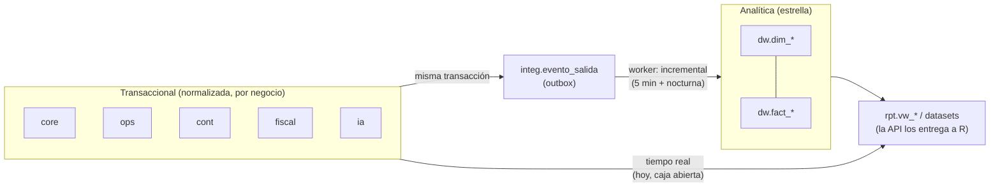
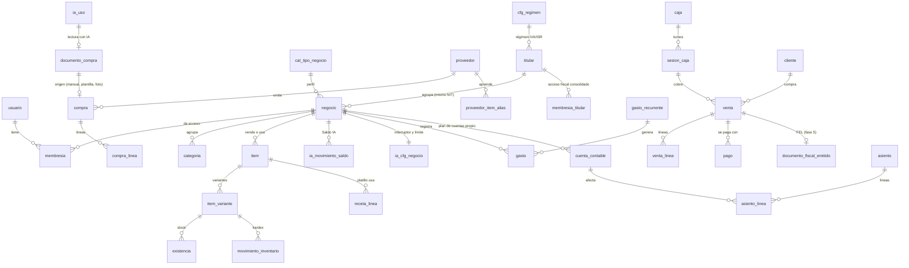

# Modelo de datos: base `integrat`

> **Fase 0 · v2 (decisiones aprobadas).** Motor, convención de nombres, esquemas, aislamiento **por negocio** con capa **titular (NIT)**, capas transaccional y analítica, diagrama y tablas iniciales.
> **Base nueva `integrat`.** La base de la v1 (`erp_pyme_gt`) no se usa nunca.
>
> ⚠️ **Actualización (D-19): el motor es MySQL 9, no PostgreSQL.** El modelo lógico de este documento (entidades, columnas, reglas) sigue vigente.
> La implementación física (prefijos en lugar de esquemas, aislamiento en la API en lugar de RLS, UUIDv7 en `BINARY(16)`, `DATETIME(6)` en UTC) está en **`CONVENCIONES_BD.md`**, que manda cuando haya diferencias.

---

## 1. Motor: PostgreSQL (17+; 18 recomendado)

| Criterio | PostgreSQL ✅ | SQL Server | MySQL (v1) |
|---|---|---|---|
| **Row-Level Security** (aislamiento por negocio en la BD) | ✅ Nativo | ✅ | ❌ |
| Esquemas dentro de una misma BD | ✅ | ✅ | ❌ |
| Licencia | Gratis | De pago (Express con límites) | Gratis |
| Restricciones diferidas (asiento cuadrado al hacer COMMIT) | ✅ | ❌ | ❌ |
| `NUMERIC`, `JSONB`, `uuidv7()` nativo (v18), particionado | ✅ | ⚠️ | ⚠️ |
| Azure: Database for PostgreSQL Flexible Server | ✅ (migración directa) | ✅ | ✅ |

---

## 2. Convención de nombres

### 2.1 Reglas generales

- Español, **snake_case**, minúsculas, sin tildes ni ñ (`anio`, `dueno`). **Tablas en singular** (`venta`, `venta_linea`).
- **PK** `id uuid DEFAULT uuidv7()`. **FK** `<tabla>_id`; si hay dos FK a la misma tabla, se agrega un rol (`cuenta_origen_id`).
- **Dinero** `NUMERIC(14,2)` · **cantidades** `NUMERIC(14,4)` · **costos unitarios** `NUMERIC(14,6)`.
- `timestamptz` para instantes (`*_en`) y `date` para fechas de negocio. La zona horaria es la **del negocio**.
- Booleanos con `es_` o `tiene_`. Estados como `text` + `CHECK` o FK a un catálogo, **nunca ENUM nativo**.
- Códigos estables legibles (`codigo text`) para la configuración y las reglas: `VENTA`, `CAJA`, `restaurante`.

### 2.2 Prefijos por tipo de objeto

| Prefijo | Objeto | Ejemplo |
|---|---|---|
| *(sin prefijo)* | Tabla transaccional normalizada | `ops.venta` |
| `cat_` | Catálogo maestro **global**, administrado por IntegraT | `cat.cat_pais`, `cat.cat_unidad_medida` |
| `cfg_` | Configuración: plantillas, reglas, parámetros (global, por titular o por negocio) | `cont.cfg_regla_contable`, `ia.cfg_negocio` |
| `dim_` / `fact_` | Dimensiones y hechos del modelo estrella | `dw.dim_item`, `dw.fact_venta_linea` |
| `vw_` / `mv_` | Vista / vista materializada | `rpt.vw_resumen_hoy` |
| `fn_` | Función sin efectos de negocio | `cont.fn_saldo_cuenta()` |
| `sp_` | Procedimiento de mantenimiento, ETL o cierre | `dw.sp_cargar_fact_venta(desde)` |
| `trg_` | Trigger | `trg_asiento_cuadrado` |
| `pk_` `fk_` `uq_` `ck_` `ix_` | Restricciones e índices | `ix_venta_negocio_fecha` |

> La **lógica de negocio no vive en `sp_`** (lección de la v1). La BD solo guarda integridad, RLS, ETL y lecturas de reporte. Las reglas están en la API (Python), con pruebas.

### 2.3 Esquemas

| Esquema | Contenido | Escribe |
|---|---|---|
| `core` | Usuario, **titular (NIT)**, **negocio**, membresías, tipos de negocio y su configuración | API |
| `cat` | Catálogos globales `cat_*` | Migraciones y semillas |
| `ops` | Catálogo del negocio, inventario, recetas, compras, gastos, ventas, caja, clientes, documentos e imágenes | API |
| `cont` | Plan de cuentas, roles, reglas, periodos y asientos (**libros por negocio**) | API (motor contable) |
| `fiscal` | Regímenes, impuestos, **consolidado por titular**, FEL (documentos y eventos) | API |
| `ia` | Configuración, saldo, recargas y uso de la IA para facturas | API + worker |
| `integ` | Outbox, webhooks, conexiones (incluye el certificador FEL), mapeo externo, idempotencia | API + worker |
| `dw` | Modelo estrella | Worker (ETL) |
| `rpt` | Vistas y datasets de lectura | Migraciones |
| `audit` | Bitácora de cambios y accesos | Triggers + API |

### 2.4 Columnas estándar

Todas las tablas de datos de un negocio llevan:

```sql
id               uuid        PRIMARY KEY DEFAULT uuidv7(),
negocio_id       uuid        NOT NULL REFERENCES core.negocio(id),  -- LLAVE DE AISLAMIENTO (RLS)
creado_en        timestamptz NOT NULL DEFAULT now(),
creado_por       uuid            NULL REFERENCES core.usuario(id),
actualizado_en   timestamptz NOT NULL DEFAULT now(),
actualizado_por  uuid            NULL,
eliminado_en     timestamptz     NULL,           -- borrado lógico
eliminado_por    uuid            NULL,
version          integer     NOT NULL DEFAULT 1  -- control optimista
```

- Índices compuestos que empiezan por `negocio_id`, por ejemplo `(negocio_id, fecha)`. Índices parciales `WHERE eliminado_en IS NULL`.
- Las restricciones únicas incluyen `negocio_id`, por ejemplo `uq_item_codigo (negocio_id, codigo) WHERE eliminado_en IS NULL`.
- Los movimientos contables, de inventario, de saldo IA y los documentos fiscales son **inmutables**: se corrigen con un reverso y no tienen borrado lógico.

### 2.5 Aislamiento: RLS por negocio + titular para lo fiscal

```sql
ALTER TABLE ops.venta ENABLE ROW LEVEL SECURITY;
ALTER TABLE ops.venta FORCE  ROW LEVEL SECURITY;
CREATE POLICY p_negocio ON ops.venta
  USING      (negocio_id = current_setting('app.negocio_id')::uuid)
  WITH CHECK (negocio_id = current_setting('app.negocio_id')::uuid);
```

- La API toma `negocio_id` **del token**, verifica la membresía del usuario y ejecuta `SET LOCAL app.negocio_id` en cada transacción.
- **Consolidado por titular (NIT):** solo para los reportes fiscales.
  - Se usan funciones `fiscal.fn_consolidado_*` (por ejemplo, `fn_consolidado_iva_mes(titular_id, anio, mes)`), declaradas `SECURITY DEFINER` y con `search_path` fijo.
  - La API las invoca **después** de verificar que el usuario tiene el rol `titular_admin` o `contador` en ese titular.
  - Devuelven solo agregados fiscales. No exponen el catálogo, los clientes ni la operación de otros negocios.
- **Prueba automática obligatoria:** con 2 negocios del mismo titular y 1 de otro titular se verifica que ninguna consulta cruza negocios y que el consolidado solo suma los negocios del titular correcto.

| Rol de BD | Uso | Permisos |
|---|---|---|
| `integrat_owner` | Migraciones | Dueño de los objetos; no se usa en ejecución |
| `integrat_api` | API y worker | DML en `core`, `ops`, `cont`, `fiscal`, `ia` e `integ`; **sujeto a RLS**; sin `BYPASSRLS` |
| `integrat_etl` | Carga de `dw` | Lectura transaccional y escritura en `dw` |
| `integrat_app_ro` | **Solo si** se elige la conexión directa de Shiny (no recomendada, `CONFIGURACION_SERVIDOR.md` §6) | `SELECT` en `rpt` y `dw`, sujeto a RLS |

### 2.6 Migraciones

- **Alembic** (`api/migrations/`) con SQL explícito para RLS, funciones, triggers y vistas. Nunca se edita una migración ya aplicada.
- Semillas (`db/semillas/`) y plantillas (`db/plantillas/*.yaml`: plan de cuentas, reglas, tipos de negocio, frases FEL), con carga idempotente.

---

## 3. Capa transaccional y capa analítica



- En el MVP, ambas capas viven en la misma base `integrat` (esquemas distintos). A escala, `dw` puede pasar a una réplica de lectura (en Azure, la réplica de Flexible Server).
- `dw.dim_item` es SCD 2 (historial de categoría, precio y costo). `dw.dim_fecha` incluye los feriados por país.
- **R no lee la BD**: recibe los datasets por la API (`PROPUESTA_ARQUITECTURA.md` §3.3), generados desde `rpt` y `dw`.

---

## 4. Diagrama inicial (capa transaccional)



> **Un solo maestro `item`** para producto, platillo, insumo y servicio (`tipo_item` + banderas). El perfil del negocio decide qué se muestra.

---

## 5. Tablas iniciales

Se omiten las columnas estándar del §2.4. Las tablas `cat_*` y `cfg_*` globales no llevan `negocio_id`.

### 5.1 `cat`: catálogos globales

| Tabla | Columnas clave |
|---|---|
| `cat_pais` | `codigo` (`GT`), nombre, moneda_codigo, zona_horaria_defecto, nombre_id_fiscal (`NIT`) |
| `cat_moneda` | `codigo` (`GTQ`), simbolo, decimales |
| `cat_unidad_medida` | `codigo` (`UN`, `KG`, `G`, `L`, `ML`, `GAL`, `LB`, `QQ`, `OZ`, `DOC`, `CAJA`), tipo, factor_base, codigo_fel |
| `cat_division_territorial` | pais_codigo, nivel (departamento, municipio), codigo, nombre, padre_id |
| `cat_tipo_negocio` | `codigo` (`ventas_en_linea`, `restaurante`, …), nombre, icono, activo |
| `cat_banco` | pais_codigo, codigo, nombre |
| `cat_canal_venta_base` | `codigo` (`whatsapp`, `instagram`, `facebook`, `tienda_web`, `mostrador`, `mesa`, `para_llevar`, `domicilio`, `app_delivery`), nombre, icono |

### 5.2 `core`: identidad, titular, negocio y configuración

| Tabla | Columnas clave |
|---|---|
| `usuario` | correo (único, `citext`), telefono, nombre, clave_hash (**argon2id**), verificado_en, ultimo_acceso_en, tamano_texto |
| **`titular`** | pais_codigo, **nit** (único por país, con dígito verificado), nombre_fiscal, tipo_persona (`individual`, `juridica`), **regimen_iva_codigo**, **regimen_isr_codigo**, afiliacion_iva (FEL), frases jsonb, politica_costo_ia (`capitalizar`, `gasto`). *Capa ligera: solo agrupa para lo fiscal. Puede quedar "pendiente" en el modo informal* |
| **`negocio`** | titular_id (nulo en el modo informal), nombre, nombre_comercial, tipo_negocio_codigo, zona_horaria, moneda_codigo, **codigo_establecimiento_sat**, direccion, division_territorial_id, codigo_postal, correo, telefono, logo_imagen_id, margen_objetivo_defecto, estado_onboarding jsonb. **Frontera de aislamiento (RLS) y de los libros contables** |
| `membresia` | usuario_id, negocio_id, rol (`dueno`, `administrador`, `cajero`, `cocina`, `contador`) |
| `membresia_titular` | usuario_id, titular_id, rol (`titular_admin`, `contador`): acceso a los **reportes consolidados** |
| `cfg_tipo_negocio_capacidad` | tipo_negocio_codigo, capacidad (`recetas`, `variantes`, `entregas`, `mesas`, `comanda_cocina`, `propinas`), activa_por_defecto |
| `cfg_tipo_negocio_vocabulario` | tipo_negocio_codigo, clave (`item_singular`, `catalogo`), texto (`platillo`, `Menú`) |
| `cfg_tipo_negocio_plantilla` | tipo_negocio_codigo, tipo (`categorias_gasto`, `categorias_item`, `plan_cuentas`, `onboarding`, `kpis_inicio`), contenido jsonb |
| `negocio_capacidad` | negocio_id, capacidad, activa (revelación progresiva) |
| `correlativo` | negocio_id, tipo_documento, prefijo, siguiente (bloqueo por fila) |

### 5.3 `ops`: operación

**Catálogo e inventario**

| Tabla | Columnas clave |
|---|---|
| `categoria` | negocio_id, nombre, orden, icono, color |
| `item` | categoria_id, tipo_item (`producto`, `platillo`, `insumo`, `servicio`, `combo`), nombre, descripcion, codigo, unidad_base_codigo, se_vende, se_compra, lleva_inventario, tiene_receta, precio_venta, precio_incluye_impuesto, margen_objetivo, **costo_promedio** (CPP), **recargo_gestion_unitario** (solo con la política IA = `gasto`), **precio_sugerido** (lo calcula la API), stock_minimo, imagen_principal_id, **bien_o_servicio** (`B`/`S`, FEL), **unidad_medida_fel** |
| `item_variante` | item_id, nombre, atributos jsonb, sku, precio_venta, costo_promedio (todo ítem tiene al menos 1 variante, que puede ser implícita) |
| `precio_canal` | item_variante_id, canal_venta_id, precio (solo si difiere) |
| `receta_linea` | item_id (platillo), insumo_variante_id, cantidad, unidad_codigo, merma_pct |
| `almacen` | nombre (`Bodega`, `Cocina`), es_principal |
| `existencia` | almacen_id, item_variante_id, cantidad, costo_promedio (proyección mantenida en la misma transacción que el movimiento) |
| `movimiento_inventario` | almacen_id, item_variante_id, fecha, tipo (`compra`, `venta`, `consumo_receta`, `ajuste`, `merma`, `conteo`, `inicial`), cantidad ±, costo_unitario, origen_tipo, origen_id. *Inmutable* |
| `imagen` | proposito (`item`, `logo`), bucket, llave_base, ancho, alto, bytes, estado, variantes jsonb |

**Compras: dos modos de carga**

| Tabla | Columnas clave |
|---|---|
| `proveedor` | nombre, nit (dígito verificado), afiliacion_iva_conocida (`GEN`, `PEQ`, desconocida), telefono |
| **`documento_compra`** | **modo_carga** (`manual`, `plantilla`, `foto_ia`), archivos jsonb (llaves R2: fotos de respaldo, plantilla), estado (`borrador`, `leyendo`, `para_revisar`, `confirmado`, `descartado`, `error`), datos_extraidos jsonb (de la plantilla o de la IA), datos_confirmados jsonb, validaciones jsonb, ia_uso_id. *Origen común de los 3 modos* |
| `compra` | proveedor_id, documento_compra_id, fecha, tipo_documento_proveedor (`FACT`, `FPEQ`, `sin_factura`, …), serie, numero, autorizacion_fel, nit_comprador_en_factura (para validar el crédito fiscal), moneda_codigo, subtotal, impuesto, impuesto_acreditable, total, **costo_flete**, **costo_ia**, condicion (`contado`, `credito`), estado, asiento_id. `uq (proveedor_id, serie, numero)` + validación de duplicados **por titular** en la API |
| `compra_linea` | compra_id, item_variante_id, descripcion_original, cantidad, unidad_codigo, factor_a_base, total_linea, impuesto, **flete_asignado**, **costo_ia_asignado**, costo_unitario_final |
| `proveedor_item_alias` | proveedor_id, texto_normalizado, item_variante_id, unidad_codigo, factor_a_base, veces_confirmado |
| `cuenta_por_pagar` | proveedor_id, compra_id, monto, saldo, vence_en |

**Gastos**

| Tabla | Columnas clave |
|---|---|
| `categoria_gasto` | nombre, es_fijo_defecto, rol_cuenta_codigo, icono |
| `gasto_recurrente` | categoria_gasto_id, descripcion, monto_estimado, frecuencia, dia, proximo_en, es_fijo |
| `gasto` | categoria_gasto_id, gasto_recurrente_id, documento_compra_id (foto de respaldo), fecha, descripcion, monto, tipo_documento (`FACT`, `FPEQ`, `sin_factura`), impuesto_acreditable, **es_deducible**, es_fijo, medio_pago, sesion_caja_id, asiento_id, estado |

**Ventas, caja y clientes**

| Tabla | Columnas clave |
|---|---|
| `canal_venta` | canal_base_codigo, nombre, activo (filas, no ENUM) |
| `cliente` | nombre, telefono, **tipo_id_fiscal** (`NIT`, `CUI`, `CF`, `EXT`), **id_fiscal**, **nombre_fiscal**, correo, notas |
| `caja` | nombre |
| `sesion_caja` | caja_id, abierta_por, abierta_en, monto_inicial, cerrada_por, cerrada_en, monto_contado, monto_esperado, diferencia, motivo_diferencia, estado (permite varias cajas y turnos) |
| `movimiento_dinero` | sesion_caja_id, tipo (`venta`, `gasto`, `retiro_dueno`, `aporte`, `deposito_banco`, `ajuste`), monto ±, medio_pago, origen_tipo, origen_id |
| `venta` | numero, fecha_hora, cliente_id, canal_venta_id, sesion_caja_id, modalidad (`mostrador`, `mesa`, `para_llevar`, `domicilio`, `envio`), referencia, subtotal, descuento, impuesto, total, costo_total, moneda_codigo, **facturar** (bool, FEL), estado (`borrador`, `pendiente_pago`, `pagada`, `entregada`, `anulada`), asiento_id, idempotency_key. *El borrador persiste en la BD (reconexión)* |
| `venta_linea` | venta_id, item_variante_id, cantidad, precio_unitario, descuento, **base_gravable**, **impuesto**, **codigo_unidad_gravable**, total, costo_unitario (congelado), notas |
| `pago` | venta_id, medio_pago, monto, referencia, comision, recibido_en |
| `cuenta_por_cobrar` | cliente_id, venta_id, monto, saldo, vence_en |
| `devolucion` | venta_id, lineas jsonb, motivo, asiento_id, documento_fiscal_id (NCRE, fase FEL) |
| `entrega` | venta_id, direccion, division_territorial_id, costo_envio, estado (capacidad `entregas`) |

### 5.4 `ia`: IA para facturas (control del usuario)

| Tabla | Columnas clave |
|---|---|
| `cfg_global` | precio_por_pagina_gtq, modelo_activo, modelo_escalamiento, paginas_incluidas_por_plan jsonb, vigente_desde (configuración de IntegraT, sin `negocio_id`) |
| `cfg_negocio` | negocio_id (único), **ia_activa** (por defecto `false`), **limite_mensual_gtq** (nulo = sin límite), aviso_pct (80), aceptado_terminos_en, aceptado_por |
| `movimiento_saldo` | negocio_id, fecha, tipo (`recarga`, `consumo`, `reembolso`, `ajuste`, `incluido_plan`), monto_gtq ± (sin IVA), iva_gtq, referencia_pago, factura_integrat (autorización FEL de IntegraT), ia_uso_id, asiento_id. *Inmutable; el saldo es la suma* |
| `uso` | negocio_id, documento_compra_id, paginas, **precio_mostrado_gtq**, **confirmado_por_usuario_en**, modelo, tokens_entrada, tokens_salida, costo_real_usd, duracion_ms, resultado (`leida`, `fallida`, `reembolsada`), campos_corregidos, campos_totales. *Alimenta el historial y la métrica de calidad* |
| `vw_saldo_negocio` (rpt) | saldo actual, consumo del mes, límite, % usado |

Reglas en la API:
- No se llama al modelo si `ia_activa = false`, si el saldo es insuficiente o si `consumo_mes + precio > limite_mensual`.
- El **precio mostrado** es el que se cobra.
- Una lectura fallida genera un `reembolso` automático (o simplemente no se cobra).

### 5.5 `cont`: contabilidad (libros por negocio)

| Tabla | Columnas clave |
|---|---|
| `cfg_rol_cuenta` | `codigo` (`CAJA`, `VENTAS`, `SALDO_IA_PREPAGADO`, …), descripcion_simple, naturaleza (global) |
| `cfg_plantilla_plan_cuentas` | pais_codigo, tipo_negocio_codigo, version, contenido jsonb |
| `cuenta_contable` | negocio_id, codigo, nombre, nombre_simple, tipo, naturaleza, padre_id, acepta_movimientos, rol_cuenta_codigo |
| `cfg_regla_contable` | pais_codigo, **regimen_codigo** (del titular), tipo_negocio_codigo, tipo_evento (`VENTA`, `COMPRA`, `GASTO`, `COBRO`, `PAGO`, `CIERRE_CAJA`, `AJUSTE_INV`, `CONSUMO_RECETA`, `RECARGA_SALDO_IA`, `CONSUMO_IA`, `DEVOLUCION`, …), **variante** (por ejemplo, `politica_costo_ia`), version, vigente_desde, lineas jsonb |
| `periodo_contable` | negocio_id, anio, mes, estado |
| `asiento` | negocio_id, periodo_id, numero, fecha, descripcion_simple, tipo_evento, origen_tipo, origen_id, regla_id + version, reverso_de_asiento_id, estado. *Inmutable* |
| `asiento_linea` | asiento_id, cuenta_contable_id, debe, haber, concepto, item_id, es_deducible |
| `trg_asiento_cuadrado` | Trigger de restricción diferido: suma del debe = suma del haber por asiento al hacer COMMIT |

### 5.6 `fiscal`: regímenes, consolidado y FEL

| Tabla / objeto | Columnas clave |
|---|---|
| `cfg_regimen` | pais_codigo, `codigo` (`GT_IVA_GENERAL`, `GT_IVA_PEQ_CONTRIBUYENTE`, `GT_ISR_UTILIDADES`, `GT_ISR_SIMPLIFICADO`, `INFORMAL`), nombre_simple, usa_credito_fiscal, parametros jsonb (tasas, límites; **a validar con el contador**), vigente_desde |
| `cfg_impuesto` | pais_codigo, codigo (`IVA`), tasa, incluido_en_precio_defecto, vigente_desde |
| `cfg_frase` | pais_codigo, tipo_frase, codigo_escenario, texto, aplica_a_regimen |
| `fn_consolidado_iva_mes(titular_id, anio, mes)` | Débito, crédito y remanente sumando los negocios del titular (`SECURITY DEFINER`) |
| `fn_consolidado_ingresos_anio(titular_id, anio)` | Para el límite del pequeño contribuyente y el ISR |
| `fn_libro_compras_ventas(titular_id, anio, mes)` | Libro consolidado por NIT |
| `documento_fiscal_emitido` | negocio_id, venta_id o devolucion_id, tipo_dte, estado (máquina de `PLAN_FEL.md` §4.2), numero_acceso, autorizacion, serie, numero, certificado_en, certificador, xml_llave_r2, documento_origen_id, idempotency_key (fase 5; la tabla existe desde el MVP) |
| `dte_evento` | documento_fiscal_id, accion, solicitud_resumen jsonb, respuesta_resumen jsonb, http_status, en (sin credenciales) |
| `declaracion` | titular_id, impuesto, periodo, base, impuesto_calculado, estado, vence_en |

### 5.7 `integ` y `audit`

| Tabla | Columnas clave |
|---|---|
| `integ.evento_salida` | negocio_id, tipo (`venta.confirmada`, `compra.confirmada`, …), agregado_tipo, agregado_id, payload jsonb, publicado_en, intentos (outbox) |
| `integ.suscripcion_webhook` / `entrega_webhook` | url, eventos[], secreto_hmac (cifrado), reintentos |
| `integ.conexion` | negocio_id o titular_id, sistema (`fel_certificador`, `shopify`, `woocommerce`, `pasarela_x`), credenciales_ref (referencia a un secreto), estado |
| `integ.mapeo_externo` | conexion_id, entidad, id_interno, id_externo |
| `integ.idempotencia` | negocio_id, llave, ruta, hash_solicitud, respuesta jsonb, expira_en |
| `audit.cambio` | negocio_id, tabla, registro_id, operacion, usuario_id, antes jsonb, despues jsonb, en |
| `audit.acceso` | usuario_id, evento, ip, user_agent, en |

### 5.8 `dw`: modelo estrella inicial

| Tabla | Grano |
|---|---|
| `dim_fecha`, `dim_negocio` (con titular y régimen), `dim_item` (SCD 2), `dim_canal`, `dim_cliente`, `dim_proveedor`, `dim_categoria_gasto`, `dim_cuenta` | — |
| `fact_venta_linea` | Una línea de venta: cantidad, ingreso_neto, impuesto, costo, margen |
| `fact_compra_linea` | Una línea de compra: costo, variación frente a la compra anterior, flete e IA asignados |
| `fact_gasto` | Un gasto: monto, es_fijo, es_deducible |
| `fact_inventario_diario` | Snapshot por variante y almacén |
| `fact_asiento_linea` | Una línea contable |
| `fact_caja_sesion` | Una sesión de caja |
| `fact_ia_uso` | Un uso de la IA: páginas, precio, costo real, resultado, campos corregidos |

### 5.9 `rpt`: vistas y datasets (los consume R vía la API)

| Vista / dataset | Pregunta que responde |
|---|---|
| `vw_resumen_hoy` | ¿Cuánto vendí hoy, cuánto gané y cuánto hay en caja? |
| `vw_resultado_mes` | Vendiste, te costó, gastaste y te queda |
| `vw_insumos_punto_equilibrio` | Costos fijos, costos variables y ventas diarias (entrada del cálculo en R) |
| `vw_item_rentabilidad` | Qué producto o platillo deja más |
| `vw_item_costo_receta` | Costo actual del platillo y precio sugerido |
| `vw_alertas_stock` | Lo que se está acabando |
| `vw_ia_historial` | Usos de la IA, costo y saldo |

---

## 6. Expansión e integración

- **Un tipo de negocio nuevo** se agrega con filas de `cat_tipo_negocio`, `cfg_tipo_negocio_*`, una plantilla de plan de cuentas y reglas si difieren. No requiere tablas nuevas.
- **Un país nuevo** se agrega con filas de `cat_pais`, `fiscal.cfg_regimen`, `cfg_impuesto`, `cfg_frase` y `cont.cfg_regla_contable`, y una plantilla del plan de cuentas.
- **Un certificador FEL nuevo** es un adaptador en Python + `integ.conexion`. No cambia el modelo.
- **Integraciones**: UUID estables, outbox, webhooks firmados y `mapeo_externo`. Nunca escriben directamente en la BD.
- **Particionado** (cuando haga falta): `movimiento_inventario`, `asiento_linea` y `venta_linea` por fecha.
