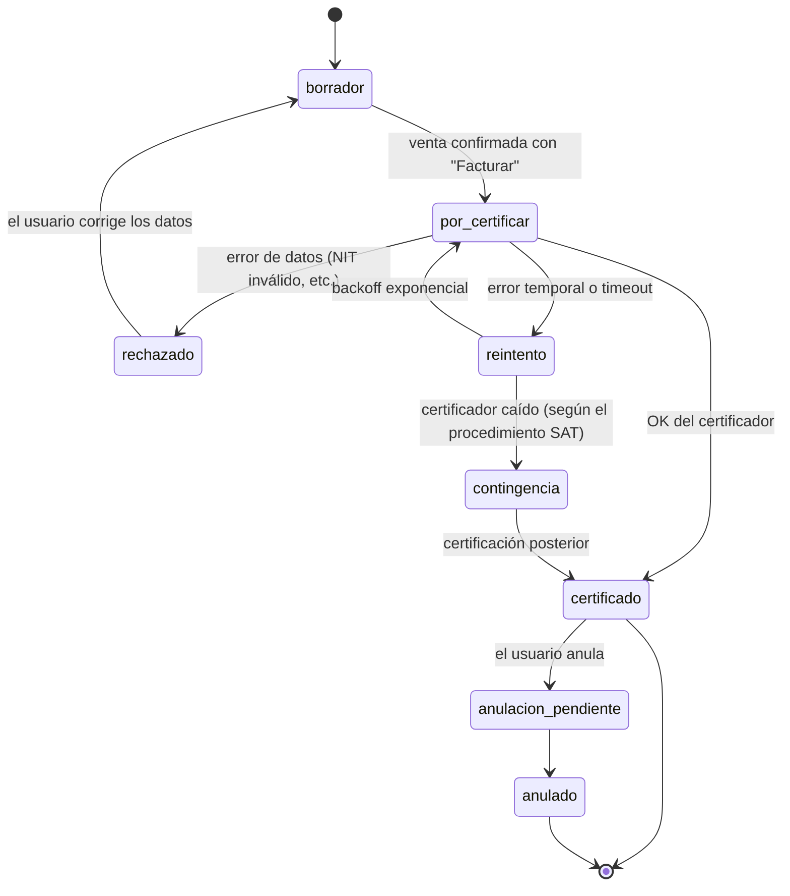

# Plan FEL: Factura Electrónica en Línea (Guatemala)

> **Fase 0 · Plan.** Decisión D-15: **no se emite FEL en el MVP**, pero la app queda **lista para incorporarla sin rediseñar**:
> el modelo de datos captura desde el MVP los campos que pide la SAT y existe una capa de integración preparada para un certificador.
>
> **Sobre las fuentes:** lo que sigue se basa en el Régimen FEL de la SAT y su esquema de documentos tal como lo conocemos.
> El portal de la SAT no estuvo accesible al redactar este documento, así que **el esquema XML vigente, los tipos de documento y las reglas deben confirmarse**
> con la documentación técnica oficial de la SAT y la del certificador elegido. Lo incierto está marcado **[verificar]**.

---

## 1. Cómo funciona la FEL (resumen)

1. El **emisor** (el titular, con su NIT) arma el documento tributario electrónico (**DTE**) en formato XML.
2. Lo envía a un **certificador** autorizado por la SAT. El certificador valida, firma, asigna el **número de autorización** (UUID) y, a partir de él, la **serie** y el **número** del documento, y lo reporta a la SAT.
3. El emisor entrega al cliente la **representación gráfica** (PDF o ticket) con los datos de certificación (y QR, según el certificador).
4. Las correcciones se hacen con **notas de crédito o débito**, o con la **anulación** del DTE (dentro de los plazos y reglas de la SAT [verificar]).
5. Si el certificador no está disponible, existe un procedimiento de **contingencia** con número de acceso y certificación posterior [verificar el procedimiento vigente].

## 2. Tipos de DTE relevantes

| Código | Documento | ¿Lo usaría IntegraT? |
|---|---|---|
| `FACT` | Factura | ✅ Ventas de régimen general |
| `FPEQ` | Factura de pequeño contribuyente | ✅ Ventas de pequeño contribuyente |
| `FCAM` | Factura cambiaria (venta al crédito) | ⚠️ Ventas al crédito (fase posterior) |
| `FCAP` | Factura cambiaria de pequeño contribuyente | ⚠️ Fase posterior |
| `NCRE` | Nota de crédito | ✅ Devoluciones y descuentos posteriores |
| `NDEB` | Nota de débito | ⚠️ Poco frecuente |
| `NABN` | Nota de abono | ⚠️ [verificar uso] |
| `FESP` | Factura especial (compras a personas que no emiten factura) | ⚠️ Compras a productores o informales (fase posterior) |
| `RECI` / `RDON` | Recibo / recibo por donación | ❌ |

La SAT tiene otros tipos (por ejemplo, regímenes agropecuarios especiales) que no aplican al MVP **[verificar la lista completa y vigente]**.

## 3. Datos requeridos por un DTE y dónde viven en `integrat`

| Bloque del DTE | Campo (esquema SAT, nombres aproximados [verificar]) | Origen en IntegraT | ¿Se captura en el MVP? |
|---|---|---|---|
| Datos generales | Tipo de DTE | `fiscal.documento_fiscal_emitido.tipo_dte` (según el régimen del titular) | Se calcula |
| | Fecha y hora de emisión | `ops.venta.fecha_hora` (zona del negocio) | ✅ |
| | Código de moneda | `ops.venta.moneda_codigo` (`GTQ`) | ✅ |
| | Número de acceso (contingencia) | `documento_fiscal_emitido.numero_acceso` | Fase FEL |
| Emisor | NIT del emisor, nombre del emisor | `core.titular.nit`, `nombre_fiscal` | ✅ |
| | Afiliación de IVA (por ejemplo `GEN`, `PEQ`) | `core.titular.afiliacion_iva` | ✅ |
| | Código de establecimiento, nombre comercial | `core.negocio.codigo_establecimiento_sat`, `nombre_comercial` | ✅ (campo opcional en el onboarding) |
| | Dirección del establecimiento (dirección, código postal, municipio, departamento, país) | `core.negocio.direccion_*` + `cat.cat_division_territorial` | ✅ |
| | Correo del emisor | `core.negocio.correo` | ✅ |
| Receptor | ID del receptor: NIT, **CUI** o `CF` | `ops.cliente.id_fiscal` + `tipo_id_fiscal` (`NIT`, `CUI`, `CF`, `EXT`) | ✅ (opcional en la venta) |
| | Nombre y correo del receptor | `ops.cliente.nombre_fiscal`, `correo` | ✅ (opcional) |
| | Regla de monto: ventas a consumidor final por encima de cierto monto requieren identificar al receptor | Validación configurable `fiscal.cfg_regimen.parametros.monto_identificacion_receptor` | Se valida cuando se active la FEL **[verificar monto y regla]** |
| Frases | Tipo de frase y código de escenario (por ejemplo, régimen de ISR, pequeño contribuyente, exento) | `fiscal.cfg_frase` + `core.titular.frases` | Configuración ✅ |
| Ítems | Número de línea | Orden de `ops.venta_linea` | ✅ |
| | Bien o servicio (`B`/`S`) | `ops.item.bien_o_servicio` | ✅ (por defecto según el tipo de ítem) |
| | Cantidad, unidad de medida, descripción | `venta_linea.cantidad`, `item.unidad_medida_fel`, `item.nombre` + notas | ✅ |
| | Precio unitario, precio, descuento | `venta_linea.precio_unitario`, `descuento` | ✅ |
| | Impuestos por línea (nombre corto `IVA`, código de unidad gravable, monto gravable, monto del impuesto) | `venta_linea.base_gravable`, `impuesto`, `codigo_unidad_gravable` | ✅ (se calcula y guarda por línea) |
| | Total de la línea | `venta_linea.total` | ✅ |
| Totales | Total de impuestos y gran total | `ops.venta.impuesto`, `total` | ✅ |
| Complementos | Referencias al documento de origen (para NCRE y NDEB: autorización, fecha y motivo del ajuste) | `ops.devolucion` → `documento_fiscal_emitido.documento_origen_id` | Fase FEL |
| | Abonos (para FCAM) | `ops.cuenta_por_cobrar` (plan de pagos) | Fase posterior |
| Certificación (respuesta) | Número de autorización (UUID), serie, número, fecha y hora de certificación, XML certificado | `fiscal.documento_fiscal_emitido.*` + XML en R2 privado | Fase FEL |

> **Regla de diseño:** desde el MVP, **cada venta guarda los importes por línea ya desglosados** (base gravable, impuesto, descuento, total)
> y **congelados** al momento de vender. Así una venta del MVP podría certificarse después sin recalcular nada.

## 4. Capa de integración preparada

### 4.1 Interfaz de certificador (Python, `api/src/integrat/fiscal/fel/`)

```
CertificadorFEL (interfaz)
  ├─ certificar(dte: DTE, idempotency_key) -> ResultadoCertificacion
  ├─ anular(autorizacion, motivo, fecha) -> ResultadoAnulacion
  ├─ consultar(autorizacion) -> EstadoDTE
  ├─ consultar_nit(nit) -> NombreContribuyente   (si el certificador lo ofrece)
  └─ representacion_grafica(autorizacion) -> PDF  (o se genera en IntegraT)

Implementaciones (adaptadores):
  ├─ CertificadorSimulado   ← se usa desde el MVP para pruebas (genera UUIDs falsos y nunca llama a la SAT)
  └─ Certificador<Proveedor> ← se agrega uno por cada certificador con el que se haga contrato
```

- `DTE` es un **modelo de dominio** independiente del XML. Cada adaptador lo traduce al formato y API de su certificador.
  La generación del XML GTDocumento se valida contra el **XSD oficial** [verificar la versión vigente del esquema].
- Las **credenciales** del certificador son de cada titular (el contrato es suyo). Se guardan en `integ.conexion` con una referencia a un secreto; nunca en claro.

### 4.2 Estados de un documento fiscal



- **Idempotencia:** una venta = un DTE. La llave de idempotencia es `venta_id + tipo_dte + intento_logico`, para que un reintento **nunca** certifique dos veces.
- **Outbox:** la certificación ocurre en el worker, disparada por el evento `venta.confirmada` cuando `facturar = true`. La venta y el cobro **no esperan** a la SAT.
- **Bitácora:** `fiscal.dte_evento` guarda cada solicitud y respuesta (sin credenciales) para auditoría.
- **Almacenamiento:** el XML certificado se guarda en R2 privado (`n/{negocio_id}/fel/{aaaa}/{mm}/{dte_id}.xml`). La representación gráfica se genera al vuelo o también se guarda.

### 4.3 Relación con la contabilidad

- La **venta** genera el asiento (la FEL no cambia la contabilidad). La FEL solo agrega número, serie y autorización a la venta y al libro de ventas.
- Una **NCRE** por devolución genera su propio asiento de reverso parcial (motor contable, evento `DEVOLUCION`).
- Una **anulación** genera el reverso total de la venta.

## 5. Qué queda listo en el MVP (checklist)

- [ ] `core.titular` con `nit`, `nombre_fiscal`, `afiliacion_iva`, régimen de ISR y frases.
- [ ] `core.negocio` con `codigo_establecimiento_sat`, `nombre_comercial` y dirección estructurada (departamento y municipio del catálogo).
- [ ] `ops.item` con `bien_o_servicio` y `unidad_medida_fel`.
- [ ] `ops.cliente` con `tipo_id_fiscal` (`NIT`, `CUI`, `CF`, `EXT`), `id_fiscal`, `nombre_fiscal` y `correo`.
- [ ] `ops.venta_linea` con `base_gravable`, `impuesto`, `codigo_unidad_gravable` y `descuento` congelados.
- [ ] Validación del **dígito verificador del NIT** (módulo 11) y del formato del CUI.
- [ ] Tablas `fiscal.documento_fiscal_emitido`, `fiscal.dte_evento` y `fiscal.cfg_frase` creadas (vacías).
- [ ] Interfaz `CertificadorFEL` + `CertificadorSimulado` con pruebas.
- [ ] En la UI: interruptor "Facturar" oculto (revelación progresiva) hasta que el negocio active la FEL.

## 6. Implementación en la Fase 5 (pasos)

1. **El titular elige un certificador** autorizado por la SAT y contrata el servicio (costo por DTE a cargo del titular).
   Hay que verificar la lista vigente de certificadores en el portal de la SAT. Se recomienda soportar primero **uno** con buena API REST, sandbox y soporte.
2. Obtener la documentación técnica y el **ambiente de pruebas** del certificador. Validar el XSD vigente.
3. Implementar el adaptador `Certificador<Proveedor>`: certificar, anular y consultar.
4. Pruebas en el sandbox: FACT, FPEQ, NCRE, anulación, NIT inválido, CF con monto alto, contingencia y reintentos.
5. Onboarding FEL en la app: "Activa tu facturación electrónica" (datos del establecimiento, credenciales del certificador y frases), con verificación final mediante un DTE de prueba.
6. Representación gráfica: ticket de 80 mm y PDF carta, con enlace para compartir por WhatsApp.
7. Libro de ventas con número de autorización. Conciliación mensual (DTE certificados frente a ventas).
8. Validación por el contador (`REVISION_CONTADOR.md` §11).

## 7. Preguntas abiertas

- [ ] ¿Qué certificador usará el piloto (preferencia del contador o de los negocios)?
- [ ] ¿Las ventas en línea cobradas contra entrega se facturan al confirmar el pedido o al cobrar?
- [ ] En restaurantes, ¿una cuenta dividida entre varias personas genera varios DTE?
- [ ] ¿Hace falta **Factura Especial** (`FESP`) en el MVP fiscal, para compras a pequeños productores sin factura?
- [ ] Confirmar el **monto** a partir del cual una venta a consumidor final debe identificar al receptor (NIT o CUI) y la regla vigente [verificar].
