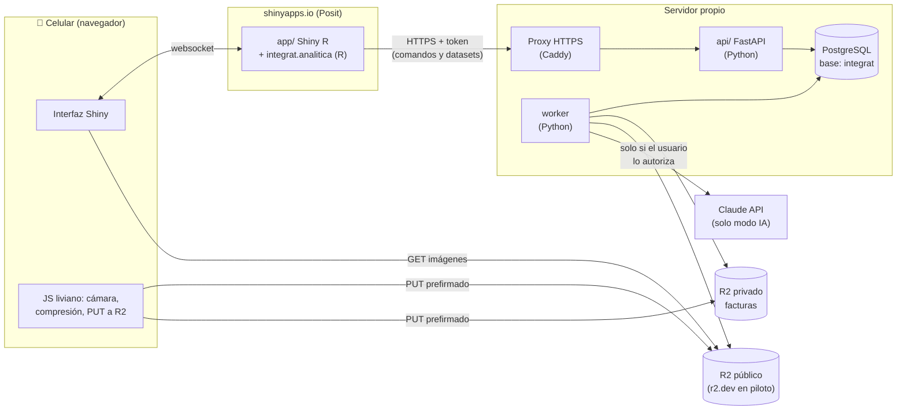
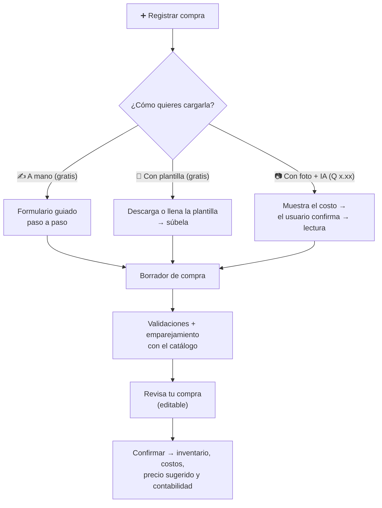

# Propuesta de arquitectura: IntegraT

> **Fase 0 · v2 (decisiones aprobadas)** · Fecha: 2026-11-23.
> Contiene el stack, la frontera R/Python, Cloudflare R2, la carga de facturas (sin IA y con IA), el cobro de la IA, el motor contable, el roadmap y los riesgos.
> ⚠️ **Actualización (D-19, D-21):** la base es **MySQL 9** y la API y la base del piloto corren en **Railway**, no en un servidor propio. Donde este documento diga PostgreSQL, RLS o servidor propio, manda `DECISIONES.md` (ver también `CONVENCIONES_BD.md` e `infra/railway.md`).
> Las decisiones están registradas en `DECISIONES.md`. Los precios de terceros son referencias a la fecha indicada y hay que **re-verificarlos antes de comprometer presupuesto**.

---

## 1. Resumen

| Tema | Decisión |
|---|---|
| Arquitectura | **Opción C, híbrida**: interfaz **Shiny para R** + **API FastAPI (Python)** + **worker Python** |
| Dueño de los datos y de la lógica de negocio | **La API (Python).** Es el único componente con credenciales de BD y R2 |
| Analítica, proyecciones, punto de equilibrio y reportes | **R** (paquete interno `integrat.analitica`), que se ejecuta dentro de la app Shiny |
| Base de datos | **MySQL 9** *(antes PostgreSQL; D-19)*, base **nueva `integrat`** en Railway. Aislamiento **por negocio** en la API (sin RLS) y capa **titular (NIT)** para lo fiscal consolidado |
| Imágenes | **Cloudflare R2**: bucket **público** para catálogo (`r2.dev` en el piloto, dominio propio en producción) y bucket **privado** para facturas |
| Facturas | **Dos modos**: sin IA (guiada a mano o con plantilla simple) y con IA (foto, opcional, con costo visible, límite mensual e historial) |
| Hospedaje del piloto | Shiny en **shinyapps.io**; API, worker y base de datos en **Railway** *(D-21)*. Todo en contenedores y configurado por variables de entorno, listo para migrar a **Azure** |
| Conexión | La app **siempre funciona en línea**. No hay modo sin conexión |
| FEL | No se emite en el MVP, pero queda **preparada** (`PLAN_FEL.md`) |

---

## 2. Stack

### 2.1 Opciones evaluadas (resumen)

| Criterio | A) Shiny R + reticulate | B) Shiny para Python | **C) Shiny R + FastAPI** ✅ |
|---|---|---|---|
| Tareas lentas (IA de facturas, de 5 a 20 s) sin congelar a otros usuarios | ❌ Bloquea el proceso R | ⚠️ | ✅ Se encargan el worker y la API |
| R para analítica | ✅ | ⚠️ Requiere un servicio R aparte | ✅ Dentro de la app |
| API para integraciones y FEL | ❌ | ⚠️ | ✅ |
| Despliegue en shinyapps.io + servidor propio | ⚠️ (Python dentro de shinyapps.io) | ⚠️ | ✅ (cada pieza en su lugar) |
| Pruebas por separado del dominio y de la UI | ⚠️ | ✅ | ✅ |

### 2.2 ¿Shiny para R o Shiny para Python en la interfaz? → **Shiny para R**

Pediste "lo que sea más moderno y tenga buenas soluciones". Las dos opciones son modernas (Shiny para R 1.9+ con bslib, Shiny para Python 1.x con Shiny Express).
Para IntegraT **gana Shiny para R** por estas razones:

1. **La analítica en R corre en el mismo proceso que la interfaz.** El punto de equilibrio, las proyecciones y los informes se calculan y se muestran sin otro servicio.
   Con Shiny para Python, R tendría que vivir en un servicio aparte (plumber o similar), que habría que hospedar y asegurar.
2. **El ecosistema de UI es más maduro**: bslib (tema, tarjetas, `input_task_button`), bsicons, `ExtendedTask` para tareas asíncronas y shinytest2 para pruebas de UI.
3. **shinyapps.io documenta el despliegue de R** (rsconnect, `R_CONFIG_ACTIVE`, IPs de salida). Python ya tiene su lugar en la API, en el servidor propio.
4. **La experiencia del equipo** (la v1) es Shiny para R.

> Si algún día se reemplaza la interfaz, por ejemplo por una app más nativa, la arquitectura C lo permite sin tocar la API, la BD ni la contabilidad.

### 2.3 Diagrama del piloto



**Recomendación R-01: shinyapps.io habla solo con la API.** La base de datos **no se expone a internet** más de lo necesario: la usa solo la API, con un usuario de mínimos privilegios.
Así, (a) no hay credenciales de BD dentro del bundle de shinyapps.io (ese fue el error de la v1) y (b) solo hay una puerta de entrada, ya protegida por TLS, tokens y límites de tasa.
La conexión directa de shinyapps.io a la base de datos queda documentada como alternativa en `CONFIGURACION_SERVIDOR.md` §5.

### 2.4 Límites de Shiny con "siempre en línea"

| Requisito | Veredicto | Mitigación |
|---|---|---|
| Mobile-first | ⚠️ Shiny no es nativo móvil | Navegación inferior propia, pantallas completas en lugar de modales, nada de tablas en el celular (ver `DISENO_UX.md` §7) |
| Señal intermitente (aunque siempre en línea) | ⚠️ Shiny depende de un websocket; si se cae, la sesión se pierde | **Estado importante en el servidor**: la venta en curso es un borrador en la BD vía API. Mensaje "Reconectando…" y reconexión automática |
| Velocidad | ✅ si se diseña bien | Módulos cargados la primera vez que se usan, datasets ya agregados por la API, imágenes `w320` en listas |
| Muchos usuarios a la vez | ⚠️ R procesa una cosa a la vez por proceso | Nada pesado en la UI. En shinyapps.io se ajustan *workers* e instancias; en Azure, réplicas con afinidad de sesión |
| Multi-negocio | ✅ | RLS por negocio + `negocio_id` solo desde el token |
| Transición de shinyapps.io | ⚠️ La documentación de shinyapps.io (septiembre de 2026) anuncia que *"shinyapps.io is moving to Posit Connect Cloud"* ("nada cambia por ahora") | La app es un contenedor portable y solo necesita una variable (`API_BASE_URL`); se puede mover a Connect Cloud o a Azure sin cambios de código |

---

## 3. Frontera R ↔ Python

### 3.1 Regla de oro

> **Python es dueño de los datos y de las reglas de negocio. R es dueño de la presentación y del análisis.**
> R nunca escribe en la BD ni en R2 directamente: **siempre pide a la API**.
> Python nunca dibuja pantallas ni calcula los análisis financieros que R ya resuelve.
> **Cada fórmula tiene un solo dueño**: no se implementa dos veces.

### 3.2 Responsabilidades

| Responsabilidad | Python (API / worker) | R (Shiny / `integrat.analitica`) |
|---|---|---|
| Interfaz, navegación y textos | — | ✅ |
| Autenticación (registro, login, tokens) | ✅ Emite el token | Guarda el token en la sesión y lo envía en cada llamada |
| Permisos y aislamiento por negocio (RLS) | ✅ | — |
| Comandos de negocio (vender, comprar, gastar, cerrar caja, ajustar) | ✅ Dentro de una transacción | Llama al endpoint y muestra el resultado |
| Inventario y **costo promedio ponderado** | ✅ | Solo muestra |
| **Precio sugerido** (costo + margen + IVA + redondeo) | ✅ (se recalcula al comprar) | Solo muestra y explica |
| **Motor contable** (asientos) | ✅ | — |
| Fiscal (IVA, régimen, consolidado por titular) y FEL | ✅ | Presenta los reportes |
| R2 (URLs prefirmadas, miniaturas) | ✅ | Pide la URL y el JS sube la foto |
| Facturas: plantilla sin IA (lectura del archivo) | ✅ | Pantallas del flujo |
| Facturas con IA (extracción, validación, costo, saldo) | ✅ | Pantallas, confirmación del costo e historial |
| Integraciones, webhooks y automatizaciones programadas | ✅ | — |
| Datasets para análisis (series de ventas, gastos, costos) | ✅ Los entrega ya filtrados por negocio | Los consume |
| **Punto de equilibrio, proyecciones, informe del mes, consejos del asesor** | — | ✅ |
| Reportes PDF y Excel para el dueño y el contador | Formato oficial (libros fiscales) | ✅ Informe del mes en lenguaje sencillo |

### 3.3 Contrato entre ambos

- **OpenAPI** publicado por la API (`/v1/openapi.json`) y versionado (`/v1`). El cliente R (`app/R/api_cliente.R`, con httr2) se prueba contra ese contrato.
- **Comandos**: `POST /v1/negocios/{id}/ventas`, etc., con el header `Idempotency-Key`. Responden con el recurso creado y los **efectos** (por ejemplo, "precio sugerido cambió").
- **Datasets para R**: `GET /v1/negocios/{id}/datasets/{nombre}?desde=&hasta=`, que devuelve JSON (o Arrow si el volumen lo pide).
  Datasets iniciales:
  - `ventas_diarias`
  - `ventas_por_item`
  - `gastos_por_categoria`
  - `costos_fijos_mes`
  - `margen_contribucion`
  - `resultado_mes`
  - `inventario_valorizado`
- **Dinero**: la API envía importes como **texto decimal** (`"1250.50"`) y R los convierte con redondeo a 2 decimales. Nunca se transporta un `float` binario.
- **Fechas** en ISO-8601 con la zona horaria del negocio.
- **Casos de prueba compartidos** (`db/casos_prueba/*.yaml`): las mismas entradas y salidas esperadas se prueban en pytest (Python) y en testthat (R).
  Por ejemplo, el dataset que entrega la API alimenta el punto de equilibrio que calcula R.

### 3.4 Cuando Python necesita un resultado de R

Ejemplo: un recordatorio automático, como "vas al 60 % de tu meta", necesita el punto de equilibrio calculado por R.

- **MVP**: los consejos y avisos que dependen de análisis en R se calculan **al abrir la app** (en Shiny) y se guardan mediante la API (`POST /v1/negocios/{id}/analitica/resultados`).
- **Después del MVP**: un contenedor **"R runner"** en el servidor (Rscript programado) ejecuta `integrat.analitica` cada noche para todos los negocios y publica sus resultados por la API.
  Python usa esos resultados para automatizaciones (WhatsApp, correo), pero **nunca recalcula** la fórmula.

---

## 4. Cloudflare R2

Fuentes: documentación oficial de Cloudflare (R2 pricing, presigned URLs, public buckets, CORS, object lifecycles), consultada el 2026-11-23.

### 4.1 Datos clave

| Tema | Dato |
|---|---|
| Precio | Estándar: US$0.015 por GB al mes. Clase A: US$4.50 por millón. Clase B: US$0.36 por millón. **Egreso gratis.** Capa gratuita mensual: 10 GB, 1 millón de operaciones A y 10 millones de B |
| Infrequent Access | US$0.01 por GB al mes, con mínimo de 30 días y US$0.01 por GB recuperado |
| URLs prefirmadas | GET, HEAD, PUT y DELETE. **POST no está soportado.** Expiran entre 1 s y 7 días. **Solo funcionan con `<ACCOUNT_ID>.r2.cloudflarestorage.com`**, no con dominio propio |
| `r2.dev` | *"Rate-limited and should only be used for development purposes"*. No se le puede poner un CNAME |
| Dominio propio | Recomendado para producción: caché de Cloudflare, WAF y reglas |
| CORS | Necesario para el PUT desde el navegador (`AllowedHeaders: Content-Type`) |
| Ciclo de vida | Expirar o pasar a IA por prefijo y días |

### 4.2 Buckets, llaves y subida

| Bucket | Acceso | Contenido |
|---|---|---|
| `integrat-publico-{entorno}` | Público, solo lectura. **Piloto: `r2.dev`**; producción: dominio propio con r2.dev desactivado | Fotos de catálogo y menú (sin EXIF), logos |
| `integrat-privado-{entorno}` | **Privado**: sin dominio y sin r2.dev | **Fotos de facturas**, plantillas cargadas, comprobantes, XML de FEL (futuro), exportaciones |

Llaves con prefijo **por negocio** y UUID inmutable:

```
publico:  n/{negocio_id}/items/{item_id}/{imagen_id}/{orig|w800|w320}.webp
          n/{negocio_id}/marca/{imagen_id}.webp
privado:  tmp/{subida_id}                                   (expira a 1 día si no se confirma)
          n/{negocio_id}/facturas/{aaaa}/{mm}/{documento_id}/p{n}.jpg
          n/{negocio_id}/plantillas/{aaaa}/{mm}/{documento_id}.xlsx
          n/{negocio_id}/fel/{aaaa}/{mm}/{dte_id}.xml       (fase FEL)
```

**Flujo de subida:**
1. El celular comprime la foto (1600 px, JPEG o WebP de ~300 KB).
2. La API emite un PUT prefirmado de 5 minutos con el Content-Type firmado.
3. El navegador sube la foto **directo a R2**.
4. La API verifica el archivo con un HEAD (tamaño y tipo).
5. El worker mueve el archivo a la llave final, quita el EXIF y genera las variantes `w320` y `w800` (Pillow).

Las fotos nunca pasan por shinyapps.io.

**Ciclo de vida:**
- `tmp/` expira a 1 día.
- Las facturas **nunca se borran automáticamente**: la retención legal se debe validar con el contador (`REVISION_CONTADOR.md` §9).
- Las facturas pasan a Infrequent Access a los 180 días.

**Credenciales:** dos tokens de R2 con mínimo privilegio (uno por bucket), solo en el `.env` de la API y el worker.

### 4.3 Piloto con `r2.dev` y cambio a dominio propio

**Piloto:**
- Se activa el acceso público de `r2.dev` **solo en el bucket público**.
- La API guarda en la BD **la llave** de cada imagen, nunca la URL completa.
- La URL se arma con `R2_PUBLIC_BASE_URL` + llave. Con eso, cambiar de dominio es solo cambiar una variable.
- `r2.dev` tiene límite de tasa. Para el volumen del piloto (decenas de negocios) es aceptable, y en las listas se usa la miniatura `w320`.

**Paso a producción (plan):**
1. Comprar o usar un dominio y agregarlo como zona en la misma cuenta de Cloudflare.
2. En el bucket público: *Settings → Custom Domains → Connect Domain* (por ejemplo, `img.<dominio>`).
3. Crear una regla de caché "Cache Everything" para ese host y activar Tiered Cache.
4. Cambiar `R2_PUBLIC_BASE_URL` en el `.env` y reiniciar la API. No se migra ningún dato, porque las llaves son las mismas.
5. **Desactivar el acceso por `r2.dev`** en el bucket.
6. Actualizar CORS con el nuevo origen de la app, si cambió.

---

## 5. Carga de facturas de compra: dos modos

### 5.1 Principio

Ambos modos producen un **borrador de compra** y terminan en la **misma pantalla "Revisa tu compra"**, con las mismas validaciones, el mismo emparejamiento con el catálogo y la misma confirmación.
**El modo sin IA no es de segunda clase**: es el camino gratuito, siempre disponible y el respaldo si la IA está apagada, sin saldo o fallando.



Además, en cualquier modo, **la foto de la factura se puede adjuntar como respaldo sin usar IA** (gratis). Se guarda en el bucket privado como evidencia.

### 5.2 Modo A: sin IA (guiado)

**A.1 A mano, en la app** (el camino por defecto):
1. **Proveedor**: buscar o "nuevo" (nombre y NIT opcional, con verificación del dígito).
2. **Datos de la factura**: fecha (hoy por defecto), serie y número (opcionales; recomendados si tiene factura), "¿Incluye IVA?" (según el régimen).
3. **Productos**: buscador con los productos o insumos que más compras arriba. Por cada línea se pide **cantidad**, **unidad** y **total de la línea** (no el precio unitario: es lo que se lee en la factura). La app calcula el unitario.
4. **Total de la factura**: la app compara la suma con el total escrito ("Coincide ✅" / "Hay Q3.50 de diferencia").
5. **¿Ya la pagaste?**: efectivo, banco o la debo.
6. → "Revisa tu compra".

**A.2 Con plantilla** (para quien compra muchas líneas o prefiere la computadora):
- **Una plantilla simple de 4 columnas obligatorias**: `Producto`, `Cantidad`, `Unidad`, `Total de la línea`, más `Código` opcional. La v1 tenía 20 columnas.
- **Los datos de cabecera no van en la plantilla**: proveedor, fecha, número y pago se piden en la app, igual que en A.1.
- La plantilla se descarga **prellenada** con los productos e insumos del negocio (lista desplegable de validación) y con instrucciones en la primera hoja.
- Se aceptan `.xlsx` y `.csv` (también exportados desde Google Sheets). Los nombres de columna se reconocen con alias tolerantes y la app muestra qué entendió antes de seguir.
- Las líneas que no coinciden con el catálogo pasan al mismo emparejamiento que la IA ("¿Qué es *ACEIT CAPULLO*?").

### 5.3 Modo B: con IA (foto), bajo control del usuario

| Control | Comportamiento |
|---|---|
| **Interruptor** | *Más → Mi negocio → Lectura de facturas con IA*: **apagado por defecto**. Al activarlo se muestra una explicación de una pantalla: qué se envía, a quién, cuánto cuesta y que las fotos se guardan en un almacenamiento privado |
| **Costo antes de procesar** | Después de tomar las fotos, y **antes** de enviarlas: "Leer esta factura (2 páginas) cuesta **Q0.80**. Tu saldo: Q18.40. [Leer con IA] [Llenar a mano gratis]" |
| **Límite mensual** | El usuario define un tope (por ejemplo, Q25 al mes). Al llegar al 80 % se avisa; al llegar al 100 % la IA se pausa hasta el mes siguiente o hasta que el usuario sube el límite. Los modos sin IA siguen disponibles |
| **Historial** | *Más → Mi negocio → Uso de IA*: fecha, factura, páginas, costo, resultado (leída, corregida, fallida, reembolsada) y saldo. Exportable |
| **Precio fijo por página** | El precio que ve el usuario es **fijo por página** y se conoce de antemano. Las variaciones de tokens las absorbe IntegraT. Así el costo mostrado es exacto, no un estimado |
| **Si la lectura falla** | No se cobra (o se reembolsa automáticamente). La foto queda guardada y se ofrece llenarla a mano |
| **Privacidad** | Solo se envía la imagen de la factura. No se mandan datos de clientes. Las fotos van al bucket **privado** y no se usan para nada más |

**Pipeline técnico (worker):**
1. Corregir la orientación.
2. Leer el **QR de la FEL** si existe (da autorización, NIT, serie y número con certeza y sin costo de IA).
3. Llamar al modelo con **salida estructurada (JSON Schema)**.
4. Pasar las **mismas validaciones** del §5.4.
5. Emparejar con el catálogo.
6. Generar el borrador.

Se registra: modelo, tokens de entrada y salida, costo real en USD, precio cobrado en Q y duración.

### 5.4 Validaciones y emparejamiento (comunes a ambos modos)

- **Sumas**: las líneas suman el total (±Q0.05).
- **IVA coherente** con el régimen. Para un comprador en régimen general con factura de proveedor en régimen general: `IVA = total × 12/112`.
  Las facturas de pequeño contribuyente no generan crédito fiscal (ver `REVISION_CONTADOR.md` §5).
- **NIT** con dígito verificador válido.
- **Fecha**: no futura y no en un periodo cerrado.
- **Duplicado** por titular: misma combinación de NIT del proveedor, serie y número.
- **Emparejamiento**:
  1. Diccionario aprendido por proveedor (`proveedor_item_alias`, que incluye el factor de unidad, por ejemplo 1 GAL = 3.785 L).
  2. Coincidencia difusa (`rapidfuzz`).
  3. "Es un producto nuevo".

  Lo que el usuario confirma se aprende.

### 5.5 Al confirmar la compra (una sola transacción en la API)

1. Entrada de inventario y **nuevo costo promedio ponderado**.
2. **Prorrateo de costos adicionales** (flete, **costo de la lectura con IA**) a las líneas de la factura (§5.6).
3. Cuenta por pagar o pago (caja o banco).
4. Crédito fiscal de IVA si aplica.
5. **Asiento contable** (motor §7).
6. **Recálculo de precios sugeridos** de los productos afectados y, en un restaurante, de **los platillos cuya receta usa esos insumos**.
7. Tarjetas de impacto ("El aceite subió 8 %…").

### 5.6 El costo de la IA dentro del costo de los productos

**Pedido:** el costo de la IA se trata **como un flete**, se reparte en los productos de esa factura y el precio sugerido lo incluye.

**Prorrateo:**
- Por **valor de la línea** (por defecto, igual que el flete): `ia_linea = costo_ia × total_linea / Σ total_lineas`.
- El redondeo es a centavos y el residuo se asigna a la línea de mayor valor.
- Se guarda en `compra_linea.costo_ia_asignado`.

**Efecto en el costo:** `costo_unitario_final = (total_linea_sin_IVA_acreditable + flete_asignado + ia_asignado) / cantidad_en_unidad_base`.
Ese costo alimenta el CPP y, por lo tanto, el precio sugerido.

**Contabilidad**, con dos políticas configurables por titular (`politica_costo_ia`):

| Política | Asiento al confirmar la compra | Precio sugerido |
|---|---|---|
| **`capitalizar` (por defecto, lo que pediste)** | Debe `INVENTARIO_*` (incluye la IA prorrateada) / Haber `SALDO_IA_PREPAGADO` | Incluye la IA vía CPP |
| `gasto` (si el contador así lo indica) | Debe `GASTO_SERVICIOS_IA` / Haber `SALDO_IA_PREPAGADO` | Sigue incluyendo la IA mediante un **recargo de gestión** por unidad (no contable), para no perder el objetivo comercial |

> **Opinión profesional (a validar):** bajo NIIF para las PYMES (Sección 13), el costo del inventario incluye los costos "directamente atribuibles" a la adquisición
> (precio, transporte, manipulación) y excluye los costos indirectos de administración. Leer una factura con IA se parece más a un costo administrativo que a un flete.
> Los montos son mínimos (centavos por producto), así que la diferencia práctica es pequeña. Aun así, **el contador debe elegir la política**.
> Ver `REVISION_CONTADOR.md` §7. El sistema permite cambiarla **por configuración, sin cambios de código**.

### 5.7 Cómo cobrarle la IA al usuario

| Opción | Ventajas | Desventajas |
|---|---|---|
| Créditos abstractos ("100 créditos") | Flexible para varios servicios de IA | El usuario no entiende cuánto es en dinero; parece un juego |
| **Saldo prepagado en quetzales** ✅ | Se entiende ("Te quedan Q18.40"). Sin deudas ni cobros sorpresa. El saldo es un tope natural. Contabilización simple (anticipo) | Requiere recargar (pasarela de pago, transferencia o tarjeta) |
| Cargo dentro del plan mensual | Cero fricción | Riesgo de facturas altas e inesperadas; hay que estimar el consumo del plan |

**Recomendación R-02: saldo prepagado en quetzales ("Saldo IA") + lecturas incluidas en el plan.**
- Cada plan incluye *N* páginas al mes (por ejemplo, 10) para probar sin fricción. Después se consume del saldo.
- Recargas de Q25, Q50 o Q100 desde la app. En el piloto también por transferencia, acreditada a mano por un administrador.
- **IntegraT emite su propia factura FEL** al usuario por cada recarga. Con ella el negocio, si está en régimen general, puede aprovechar el crédito fiscal del IVA.
  Ver `REVISION_CONTADOR.md` §7 para el momento en que se genera el IVA.
- Precio por página: se fija **después** de la prueba de modelos (`PRUEBA_MODELOS_IA.md`). Fórmula: `costo real por página × tipo de cambio × (1 + margen para cubrir reintentos, almacenamiento, comisiones de la pasarela e IVA)`.

**Contabilidad del saldo (en los libros del negocio usuario):**

| Momento | Debe | Haber |
|---|---|---|
| Recarga de Q100 con factura de IntegraT (régimen general) | `SALDO_IA_PREPAGADO` 89.29 · `IVA_CREDITO` 10.71 | `BANCO` o `CAJA` 100 |
| Lectura de una factura (Q0.80, ya sin IVA) | `INVENTARIO_*` (prorrateado) o `GASTO_SERVICIOS_IA` | `SALDO_IA_PREPAGADO` 0.80 |
| Lectura fallida | Sin asiento (no se cobra) | — |
| Lecturas incluidas en el plan | Ver la contabilización de la suscripción en `REVISION_CONTADOR.md` §7 | — |

---

## 6. Base de datos (resumen; el detalle está en `MODELO_DATOS.md`)

- MySQL 9, base **nueva `integrat`** en Railway. **La base de la v1 (`erp_pyme_gt`) nunca se usa.**
- Esquemas: `core`, `cat`, `ops`, `cont`, `fiscal`, `ia`, `integ`, `dw`, `rpt` y `audit`.
- **RLS por `negocio_id`**. La capa `core.titular` agrupa negocios con el mismo NIT para lo fiscal consolidado.
- UUIDv7, columnas de auditoría, borrado lógico, versión optimista y migraciones con Alembic.

---

## 7. Motor contable automático

Se mantiene el diseño de la v1 de esta propuesta, **ajustado por las decisiones**:

1. **Libros por negocio**: cada negocio tiene su propio plan de cuentas (creado desde la plantilla), sus periodos y sus asientos.
2. **Régimen fiscal del titular (NIT)**: las reglas contables de un negocio se eligen por `país + régimen del titular + tipo de negocio + tipo de evento`.
3. **Consolidación fiscal** (IVA y libros de compras y ventas por NIT) en `fiscal`, sumando los negocios del titular. No se mezclan los libros.
4. Eventos nuevos: `RECARGA_SALDO_IA`, `CONSUMO_IA` (y la variante dentro de `COMPRA` cuando se capitaliza).
5. Se mantienen igual:
   - Asiento inmutable, con reverso para "deshacer".
   - Asiento cuadrado mediante un trigger diferido.
   - CPP.
   - Reglas en `cont.cfg_regla_contable`, que traducen conceptos a **roles de cuenta**, y estos a las cuentas del plan.

**Operaciones (régimen general, IVA 12 % incluido):**

| Evento | Debe | Haber |
|---|---|---|
| Venta en efectivo Q112 (costo Q60) | `CAJA` 112 · `COSTO_VENTAS` 60 | `VENTAS` 100 · `IVA_DEBITO` 12 · `INVENTARIO_MERCADERIA` 60 |
| Venta con tarjeta (comisión 3.5 %) | `POR_COBRAR_PASARELA` 108.08 · `GASTO_COMISIONES` 3.92 · `COSTO_VENTAS` 60 | `VENTAS` 100 · `IVA_DEBITO` 12 · `INVENTARIO_MERCADERIA` 60 |
| Venta de platillo Q56 (receta Q18) | `CAJA` 56 · `COSTO_VENTAS` 18 | `VENTAS` 50 · `IVA_DEBITO` 6 · `INVENTARIO_INSUMOS` 18 |
| Compra al crédito Q1,120 + IA Q0.80 (capitalizar) | `INVENTARIO_*` 1,000.80 · `IVA_CREDITO` 120 | `PROVEEDORES` 1,120 · `SALDO_IA_PREPAGADO` 0.80 |
| Gasto fijo con factura (renta Q2,240) | `GASTO_RENTA` 2,000 · `IVA_CREDITO` 240 | `BANCO` 2,240 |
| Gasto sin factura (Q50) | `GASTO_*` 50 (marcado **no deducible**) | `CAJA` 50 |
| Cierre de caja con faltante de Q20 | `DIFERENCIA_CAJA` 20 | `CAJA` 20 |
| Liquidación de IVA (en el negocio) | `IVA_DEBITO` | `IVA_CREDITO` · `IMPUESTO_POR_PAGAR` |
| Anulación | Reverso exacto + reingreso de inventario | |

**Pequeño contribuyente:**
- No se separa el IVA.
- El IVA pagado en compras **se suma al costo**.
- Cada mes se provisiona el impuesto sobre ingresos (`IMPUESTO_PEQ_CONTRIBUYENTE` / `IMPUESTO_POR_PAGAR`).

Todo esto se detalla y justifica en `REVISION_CONTADOR.md`.

---

## 8. Asesor financiero y punto de equilibrio (R)

- **Punto de equilibrio mensual** (en `integrat.analitica`): `PE = costos_fijos_mes / margen_contribucion_%`, con `margen_contribucion_% = 1 − costos_variables / ventas`.
  - **Cuánto**: "Necesitas vender Q18,500 este mes".
  - **Cuándo**: con el ritmo diario (promedio móvil de 14 días ajustado por día de la semana), "Lo alcanzas el día 21".
  - **Hoy**: "Necesitas vender Q720 hoy".
- **Proyecciones**: cierre de mes estimado (ventas, gastos y ganancia) con banda de confianza simple. Más adelante, estacionalidad.
- **Informe del mes** en lenguaje sencillo, con PDF en R (Quarto o rmarkdown).
- **Consejos por reglas** deterministas: margen bajo, alza de costo, producto sin ventas, gasto que vence, caja sin cerrar y día flojo.
  Un LLM solo podría redactarlos más adelante; los números siempre vienen del cálculo.
- **Precio sugerido**: el dueño es Python (§3.2); R lo muestra y lo explica ("De cada Q100 que vendas, te quedan Q35").

---

## 9. Integraciones y FEL (API-first)

- REST `/v1` con OpenAPI, `Idempotency-Key` y **outbox transaccional** → webhooks firmados con HMAC y reintentos.
- `integ.mapeo_externo` para los IDs de tiendas en línea, delivery y pasarelas.
- **FEL**: la capa `fiscal` + `integ` incluye una interfaz de certificador lista para conectarse. Ver `PLAN_FEL.md`.

---

## 10. Privacidad y seguridad (puntos para la política de privacidad)

La política de privacidad debe declarar, al menos:

1. **Fotos de facturas** y plantillas: se guardan en un **almacenamiento privado** (Cloudflare R2, bucket privado). Solo las ven los usuarios autorizados del negocio, mediante enlaces temporales de pocos minutos.
2. **Lectura con IA** (opcional): si el usuario la activa, la imagen se envía a un proveedor de IA (Anthropic) **solo para extraer los datos**.
   Hay que revisar y citar la política de retención de datos del proveedor vigente al momento de publicar.
3. **Fotos de catálogo**: son públicas por diseño (se muestran a clientes) y se les quitan los metadatos (EXIF, ubicación).
4. Qué datos se guardan, para qué, por cuánto tiempo (retención legal contable, ver `REVISION_CONTADOR.md` §9), dónde (servidor propio en el piloto, Azure después) y cómo pedir su exportación o eliminación.
5. **Ubicación de los datos**: shinyapps.io está en AWS `us-east-1` (EE. UU.); Cloudflare R2 y Anthropic también están fuera de Guatemala.

**Seguridad:**
- Contraseñas con argon2id.
- Tokens de corta duración.
- RLS por negocio y pruebas automáticas de aislamiento.
- Credenciales **solo en `.env`**, nunca en código, documentos ni logs. Los logs registran IDs, no secretos ni datos fiscales completos.
- Backups cifrados.

---

## 11. Roadmap

| Fase | Alcance | Criterio de salida |
|---|---|---|
| **0. Análisis** ✅ | Documentos de `docs/` + decisiones | Aprobación (hecho) |
| **1. Fundaciones** | Repo y CI, `docker compose`, base `integrat` con esquemas, RLS y migraciones, auth, titular/negocio/membresía, perfiles de tipo de negocio, esqueleto de la API, esqueleto Shiny mobile-first desplegado en shinyapps.io hablando con la API por HTTPS, sistema de diseño | Prueba de aislamiento entre 2 negocios en verde; la app desplegada en shinyapps.io funciona en un celular real |
| **2. MVP núcleo** | Onboarding, catálogo o menú con fotos (R2), ventas + caja, gastos fijos y variables, inventario, **compras sin IA (a mano y con plantilla)**, motor contable, panel de Inicio | Un negocio de cada tipo opera una semana; todos los asientos cuadran |
| **3. Diferenciadores** | **Prueba de modelos (30 facturas)** → **compras con IA** (saldo, límite, historial, prorrateo), recetas y costo por platillo, precio sugerido con avisos, punto de equilibrio, informe del mes, consejos | Modelo elegido con datos; menos del 10 % de campos corregidos; 5 personas entienden el informe sin ayuda |
| **4. Piloto** | 5 negocios en línea + 5 restaurantes en Guatemala; **revisión del contador** (`REVISION_CONTADOR.md`) antes de empezar | Metas de `VISION_PRODUCTO.md` §8 |
| **5. Fiscal GT** | Consolidado por titular, libros de compras y ventas exportables, declaración asistida de IVA, **emisión FEL** con un certificador (`PLAN_FEL.md`), clientes y crédito, roles | El contador valida los libros de 3 negocios |
| **6. Crecimiento y Azure** | Migración a Azure (`CONFIGURACION_SERVIDOR.md` §7), dominio propio + R2 con dominio, integraciones (tiendas, delivery, pasarelas), "R runner", nuevos tipos de negocio; **despachos, marketing de Instagram y planilla** | — |

---

## 12. Riesgos

| Riesgo | Prob. / impacto | Mitigación |
|---|---|---|
| Shiny se siente lento con la señal móvil | Media / Alta | Estado en el servidor, pantallas livianas y reconexión. La arquitectura permite cambiar la interfaz |
| Cambio de shinyapps.io a Posit Connect Cloud | Media / Media | App en contenedor y configurada solo por variables; plan de Azure listo |
| API sin dominio = no hay HTTPS válido para que shinyapps.io la llame | Alta / Alta | **R-03**: nombre de host DNS (gratuito o un dominio barato) + certificado Let's Encrypt (`CONFIGURACION_SERVIDOR.md` §4) |
| Errores de lectura de facturas que dañan costos | Media / Alta | Revisión obligatoria, validaciones, prueba de modelos y "deshacer" mediante reverso |
| Reglas fiscales mal parametrizadas | Media / Alta | `REVISION_CONTADOR.md` antes del piloto; reglas versionadas con pruebas |
| Fuga de datos entre negocios | Baja / Crítica | RLS + `negocio_id` del token + pruebas automáticas |
| `r2.dev` con límite de tasa en el piloto | Baja / Media | Miniaturas, pocos negocios y plan de dominio propio (§4.3) |
| Servidor propio: disponibilidad y backups | Media / Alta | Backups diarios cifrados fuera del servidor, monitoreo, UPS o nube como respaldo; migración a Azure en la fase 6 |
| Alcance excesivo | Alta / Alta | MVP con 2 tipos de negocio y 5 secciones; despachos, Instagram y planilla quedan para después |
